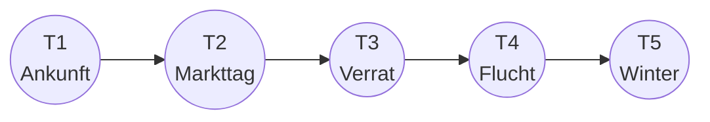
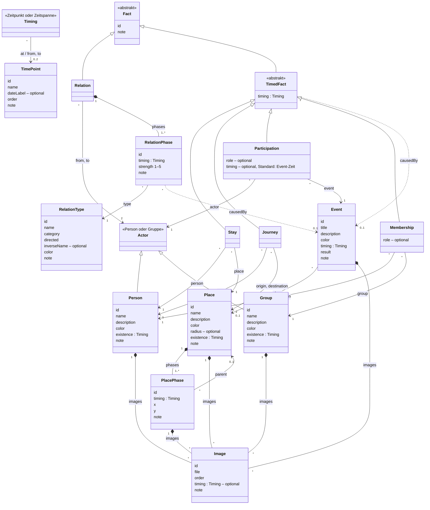
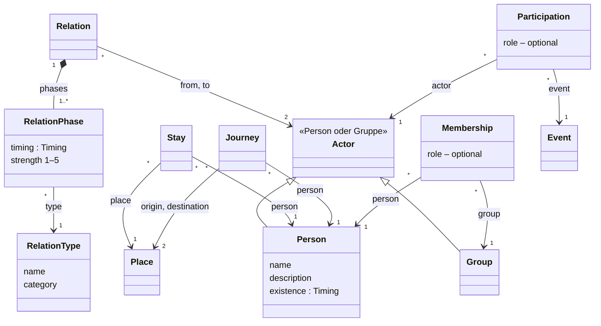
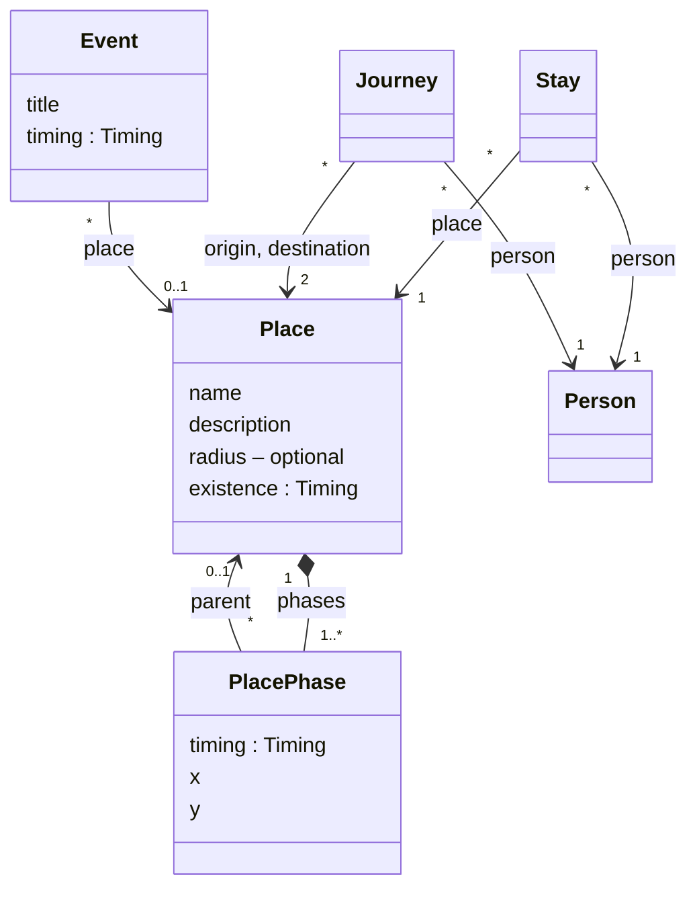
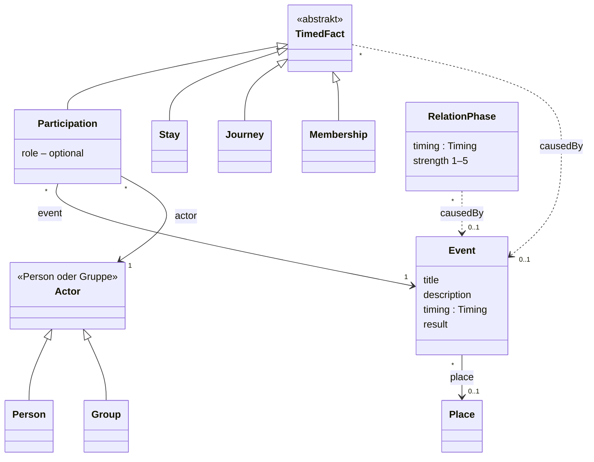
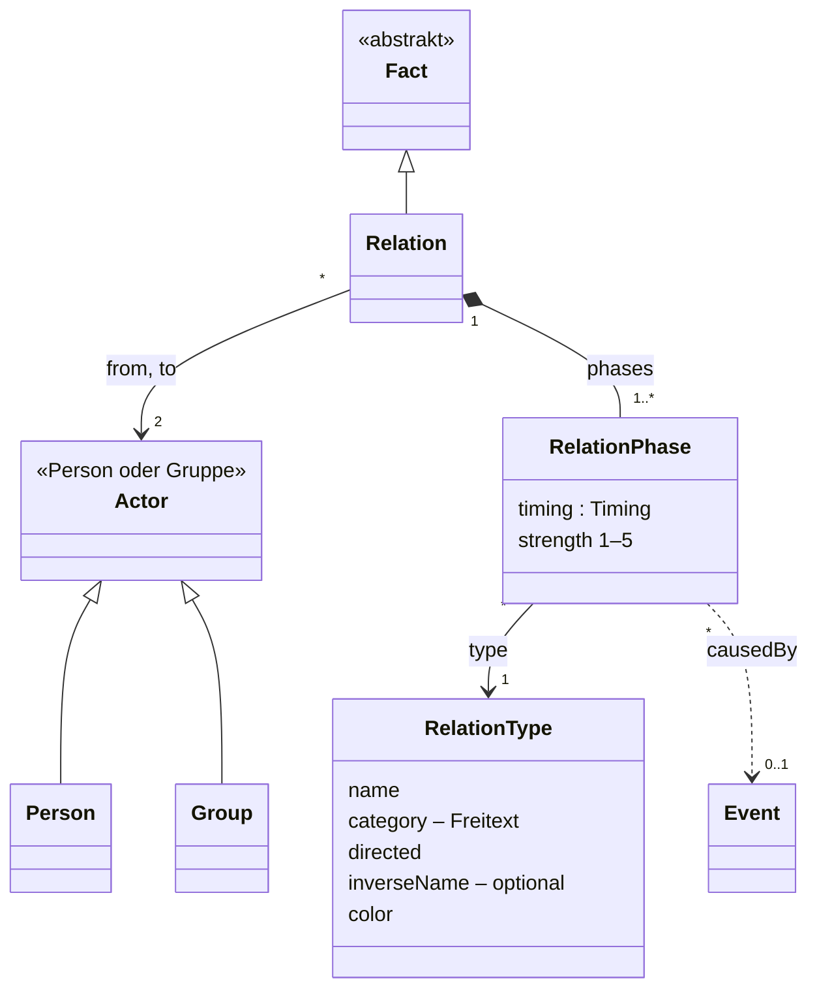
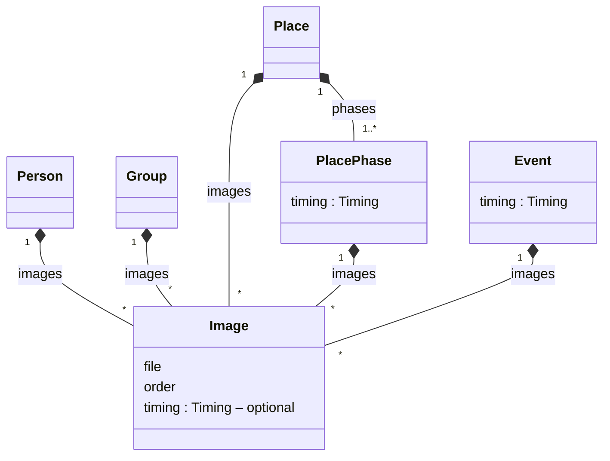
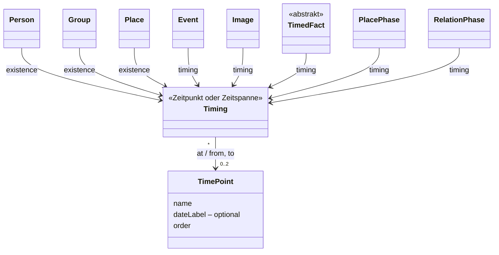
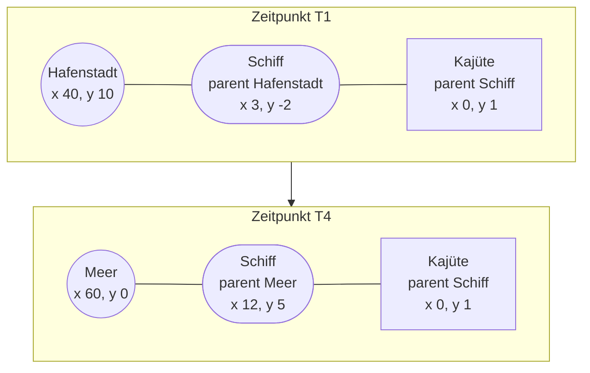

# Vorschlag: Datenmodell (Neuanfang)

Status: **akzeptiert (2026-10-18)**

Erweitert durch [2026-10-zeitpunkt-hintergrund.md](2026-10-zeitpunkt-hintergrund.md) (Hintergrundbild für Zeitpunkte).

Ziel: ein fachliches Modell für Personen, Gruppen, Orte, Events und Zeit, unabhängig von Datenbank und
Darstellung. Das Datenbank-Schema und die Oberfläche folgen erst nach Freigabe dieses Modells.

## Grundidee: Alles ist zeitlich begrenzt

Es gibt **Dinge** (Person, Gruppe, Ort, Event) und **Fakten**, die Dinge miteinander verbinden (Person A
liebt B, Person ist an Ort X, Person nimmt an Event Y teil). Jedes Ding und jeder Fakt gilt zu einem
**Zeitpunkt** oder während einer **Zeitspanne**. Ein Zeitpunkt ist ein benannter Punkt in der Geschichte,
und alle Zeitpunkte liegen in einer festen Reihenfolge.

Der Zustand der Welt zu einem Zeitpunkt *t* ist: **alle Fakten, deren Zeit *t* einschließt.**



| Fakt | T1 | T2 | T3 | T4 | T5 |
|---|---|---|---|---|---|
| Mira ist in der Hafenstadt | ■ | ■ | | | |
| Mira ist in der Taverne (liegt in der Hafenstadt) | | | ■ | ■ | |
| Mira ist unterwegs Taverne → Bergdorf | | | | ■ | ■ |
| Mira ist im Bergdorf | | | | | ■ |
| Beziehung Mira → Joren, Phase 1: Freunde, Stärke 4 | ■ | ■ | | | |
| Beziehung Mira → Joren, Phase 2: misstraut, Stärke 2, *ausgelöst durch* „Verrat“ | | | ■ | | |
| Beziehung Mira → Joren, Phase 3: hasst, Stärke 5 | | | | ■ | ■ |
| Event „Verrat“ in der Taverne, Mira, Joren und die Gruppe „Hafenwache“ beteiligt | | | ● | | |

Bei T4 und T5 überschneiden sich Aufenthalt und Reise am Grenzpunkt: Bei T4 bricht Mira auf, bei T5 kommt
sie an (siehe Festlegung 10).

## Modell



Verweise auf andere Klassen sind als Pfeile mit Rollenname und Anzahl dargestellt. Hat eine Klasse zwei
Verweise auf dieselbe Klasse, steht ein Pfeil mit beiden Rollennamen (z. B. `from, to`). Nur `Timing`
steht als Attribut: Es ist ein Wert wie ein Datum, und ein Pfeil von fast jeder Klasse dorthin würde das
Diagramm unlesbar machen.

- **`Fact`** ist die abstrakte Oberklasse aller Fakten. Sie hat nur `id` und `note`.
- **`TimedFact`** sind Fakten mit eigener Zeit und optionalem Auslöser (`causedBy`): Aufenthalt, Reise,
  Teilnahme, Mitgliedschaft.
- **`Relation`** hat keine eigene Zeit. Zeit und Auslöser stehen in ihren Phasen (siehe Festlegung 8).
- **Jede Klasse hat eine zeitunabhängige `note`**, die Fakten erben sie von `Fact`. In den Teilansichten
  ist `note` der Übersicht halber weggelassen.

### Teilansichten

Die folgenden Diagramme zeigen jeweils nur den Ausschnitt, der für eine Frage relevant ist. Es ist dasselbe
Modell, nur aus einem anderen Blickwinkel. Die Fakt-Klassen sind darin ohne `timing` gezeichnet.

#### Aus Sicht einer Person

*Mit wem steht sie wie in Beziehung, wo ist sie, wohin reist sie, woran nimmt sie teil, wozu gehört sie?*



#### Aus Sicht eines Ortes

*Wo liegt er wann, worin liegt er, wer ist dort oder reist hin bzw. weg, was passiert dort?*



#### Aus Sicht eines Events

*Wann und wo findet es statt, wer ist beteiligt, und was hat es ausgelöst?*



Über `causedBy` zeigt das Event sein Ergebnis: welche Aufenthalte, Reisen, Mitgliedschaften und
Beziehungsphasen durch es begonnen haben.

#### Beziehungen

*Wie ist eine Beziehung aufgebaut, und wer kann sie haben?*



#### Bilder

*Wer kann Bilder haben, und welches gilt zu einem Zeitpunkt?*



#### Zeit

*Was hängt alles an Zeitpunkten?* Hier ist `Timing` ausnahmsweise als Klasse mit Pfeilen gezeichnet.



### Anforderungen und ihre Abbildung

| Anforderung | Im Modell |
|---|---|
| Person hat Beziehungen (Familie, Gefühle, …) | `Relation` mit Phasen, jede Phase mit einem `RelationType` |
| Art, Stärke und Freitext ändern sich über die Zeit | Phasen einer `Relation` (Festlegung 8) |
| „sind eine Gruppe“ | `Group` + `Membership` (Festlegung 4) |
| Gruppen nehmen an Events teil und haben Beziehungen | `Actor` = Person oder Gruppe, verwendet in `Relation` und `Participation` |
| Orte liegen in Orten (Taverne in Hafenstadt) | `parent` in der Orts-Phase (Festlegung 9) |
| Ort hat eine Position in der Welt, die sich über die Zeit ändern kann | Orts-Phase mit `x`/`y` auf der 2D-Karte, relativ zum Elternort (Festlegung 9) |
| Person ist an einem Ort | `Stay` |
| Person ist auf dem Weg zwischen zwei Orten | `Journey` (Festlegung 10) |
| Orte werden von Leuten besucht | derselbe `Stay`, nur aus Sicht des Ortes. Es gibt keinen zweiten Datensatz, der davon abweichen kann. |
| Person oder Gruppe nimmt an Event teil | `Participation`, optional mit Rolle und eigener Zeit (Festlegung 6) |
| Person, Gruppe oder Ort existiert in einer Zeitspanne | `existence` (Geburt–Tod, Gründung–Auflösung, Gründung–Zerstörung) |
| Event in Zeitspanne oder zu Zeitpunkt, an einem Ort | `Event.timing` + `Event.place` |
| Event hat ein Ergebnis | `Event.result` + Fakten und Beziehungsphasen mit `causedBy` (Festlegung 5) |
| Alles zu Zeitpunkt oder Zeitspanne | `Timing` an jedem Ding, jedem zeitlichen Fakt und jeder Phase (Festlegung 2) |
| Personen, Gruppen, Orte, Orts-Phasen und Events haben Bilder | `Image`, mehrere pro Element, optional zeitlich begrenzt (Festlegung 11) |
| Jede Klasse hat eine zeitunabhängige Notiz | `note` in Markdown an jeder Klasse (Festlegung 12) |
| Personen, Gruppen, Orte und Events haben eine Farbe | `color`, Pflichtfeld, zeitunabhängig (Festlegung 15) |

### Skizze in TypeScript

```ts
/** at = genau ein Zeitpunkt; from/to = Spanne, fehlende Grenze = Anfang bzw. Ende der Geschichte */
type Timing = { at: string } | { from?: string; to?: string }

interface TimePoint { id: string; name: string; dateLabel?: string; order: number; note?: string }
interface Image { id: string; file: string; order: number; timing?: Timing; note?: string }

interface Person { id: string; name: string; description: string; color: string; existence: Timing; images: Image[]; note?: string }
interface Group { id: string; name: string; description: string; color: string; existence: Timing; images: Image[]; note?: string }
interface PlacePhase { id: string; timing: Timing; parent?: string; x: number; y: number; images: Image[]; note?: string }
interface Place { id: string; name: string; description: string; color: string; radius?: number; existence: Timing; phases: PlacePhase[]; images: Image[]; note?: string }
interface Event { id: string; title: string; description: string; color: string; timing: Timing; place?: string; result: string; images: Image[]; note?: string }

interface RelationType { id: string; name: string; category: string; directed: boolean; inverseName?: string; color: string; note?: string }
interface RelationPhase { id: string; timing: Timing; type: string; strength: 1 | 2 | 3 | 4 | 5; causedBy?: string; note?: string }

interface Relation { kind: 'relation'; id: string; from: string; to: string; phases: RelationPhase[]; note?: string }
interface Stay { kind: 'stay'; id: string; person: string; place: string; timing: Timing; causedBy?: string; note?: string }
interface Journey { kind: 'journey'; id: string; person: string; origin: string; destination: string; timing: Timing; causedBy?: string; note?: string }
/** Ohne timing gilt die Zeit des Events */
interface Participation { kind: 'participation'; id: string; actor: string; event: string; role?: string; timing?: Timing; causedBy?: string; note?: string }
interface Membership { kind: 'membership'; id: string; person: string; group: string; role?: string; timing: Timing; causedBy?: string; note?: string }
type Fact = Relation | Stay | Journey | Participation | Membership

interface Book {
  title: string
  note?: string
  timePoints: TimePoint[]
  persons: Person[]
  groups: Group[]
  places: Place[]
  events: Event[]
  relationTypes: RelationType[]
  facts: Fact[]
}

/** Alle Fakten, die zum Zeitpunkt t gelten; eine Relation nur, wenn eine ihrer Phasen t einschließt */
function factsAt(book: Book, t: string): Fact[]

/** Weltposition eines Ortes zum Zeitpunkt t: eigene Position + Positionen aller Elternorte zu t */
function worldPosition(book: Book, place: string, t: string): { x: number; y: number } | undefined

/** Erstes zum Zeitpunkt t gültiges Bild eines Elements; bei Orten zuerst die Bilder der aktuellen Phase */
function imageAt(book: Book, owner: string, t: string): Image | undefined
```

Alle Verweise laufen über `id`, nie über Namen.

## Festlegung 1: Was ist ein Zeitpunkt?

Ein Zeitpunkt hat einen Namen („Verrat“), eine Reihenfolge (`order`) und optional einen Anzeigetext zur
Einordnung (`dateLabel`, z. B. „Frühling, Jahr 3“). Die Zeitpunkte bilden die chronologische Reihenfolge
der *Geschichte*.

| Option | Bewertung |
|---|---|
| **Benannte Punkte in fester Reihenfolge** (festgelegt) | Kein Kalender nötig, passt zu jeder Welt. Ein Zeitpunkt lässt sich zwischen zwei andere einschieben. |
| Kalenderdatum der Welt | Verworfen: Für jede Szene müsste ein Datum festgelegt werden, auch wenn es egal ist. |
| Benannte Punkte + Datum zum Rechnen | Verworfen: Abstände („3 Tage später“) werden derzeit nicht gebraucht. Der Anzeigetext `dateLabel` deckt die Einordnung ab. |
| Erzählreihenfolge (Kapitel, Rückblenden) im selben Modell | Verworfen: Das ist ein eigenes Konzept, bei dem Kapitel auf Zeitpunkte oder Events verweisen. Es ist nicht Teil dieses Vorschlags. |

## Festlegung 2: Zeitangaben (`Timing`)

- `at: T` gilt genau bei T. Es ist die Kurzform von `from: T, to: T`.
- `from: T1, to: T2` gilt bei T1, T2 und allen Zeitpunkten dazwischen. Die Grenzen sind eingeschlossen.
- Fehlt `from`, gilt die Zeit seit Beginn der Geschichte. Fehlt `to`, gilt sie bis zum Ende. Fehlen
  beide, gilt sie immer.
- `from` liegt vor oder auf `to`. Andere Werte sind ungültig und werden beim Bearbeiten verhindert.

| Option | Bewertung |
|---|---|
| **Grenzen eingeschlossen, offene Enden = Anfang/Ende der Geschichte** (festgelegt) | Entspricht dem Lesen von „von T1 bis T2“. Offene Enden sind eindeutig auswertbar. |
| Fehlende Grenze = „unbekannt“ | Verworfen: Dann ließe sich nicht sagen, ob ein Fakt zu einem Zeitpunkt gilt. |
| Grenze am Ende ausgeschlossen (`to` gilt nicht mehr) | Verworfen: „bis T2“ würde T2 nicht einschließen, das ist missverständlich. |
| Nur Spannen, kein `at` | Verworfen: `at` ist die häufigste Angabe und als Kurzform bequemer. |

## Festlegung 3: Zustände statt Änderungen

Zustände werden als Fakten mit Zeitspanne gespeichert: „Mira ist von T1 bis T2 in der Hafenstadt.“
`computeStates` in `src/model.ts` wird durch `factsAt` ersetzt.

| Option | Bewertung |
|---|---|
| **Fakten mit Zeitspanne** (festgelegt) | Ein Zustand ist direkt sichtbar und bearbeitbar. „Wer ist wann wo?“ beantwortet ein einfacher Filter. |
| Änderungen pro Event (wie bisher `appear`/`move`/`exit`) | Verworfen: Den Zustand gibt es nur durch Nachrechnen. Für eine frühe Änderung muss man das spätere Gegenstück (z. B. das `exit`) suchen und mitpflegen. |

## Festlegung 4: Gruppen

Eine Gruppe ist ein eigenes Element mit Namen, Beschreibung, Lebenszeit und Bildern. Mitglieder kommen und
gehen über `Membership` (mit Zeitspanne, optional mit Rolle). Eine Gruppe kann an Events teilnehmen und
Beziehungen haben. Einen eigenen Aufenthaltsort hat sie nicht: Sie ist dort, wo ihre Mitglieder sind.

| Option | Bewertung |
|---|---|
| **Eigenes Element, ohne eigenen Aufenthalt** (festgelegt) | Die Gruppe hat einen Namen und eine eigene Geschichte. Fünf Personen sind fünf Mitgliedschaften. Der Ort ergibt sich aus den Mitgliedern, sodass keine zweite Angabe davon abweichen kann. |
| Gruppe als Beziehungsart zwischen je zwei Personen | Verworfen: Fünf Personen wären zehn Beziehungen, und die Gruppe hätte keinen Namen und keine Geschichte. |
| Gruppe mit eigenem Aufenthalt und eigenen Reisen | Verworfen: Ort der Gruppe und Orte der Mitglieder könnten sich widersprechen. |

## Festlegung 5: Ergebnis eines Events

Das Ergebnis steht als Markdown-Text am Event (`result`). Zusätzlich kann jeder zeitliche Fakt und jede
Beziehungsphase auf das Event verweisen, das sie ausgelöst hat (`causedBy`): „Misstrauen beginnt,
ausgelöst durch *Verrat*“. Ein ausgelöster Fakt darf frühestens am Zeitpunkt beginnen, an dem das Event
beginnt.

| Option | Bewertung |
|---|---|
| **Text + „ausgelöst durch“** (festgelegt) | Am Event sieht man, was sich durch es geändert hat. Von einer Beziehung springt man zum Grund. |
| Nur Text | Verworfen: keine Verbindung zu dem, was sich tatsächlich ändert. |
| Ergebnis als eigene Liste von Änderungen am Event | Verworfen: Dieselbe Information stünde doppelt im Event und im Fakt. |
| Ausgelöster Fakt erst nach dem Event-Zeitpunkt | Verworfen: Folgen treten oft im selben Moment ein. Das würde zusätzliche Zeitpunkte erzwingen. |

## Festlegung 6: Teilnahme an Events

Eine Teilnahme verbindet eine Person oder Gruppe mit einem Event, optional mit Rolle („Anführer“,
„Zeuge“). Ohne eigene Zeitangabe gilt die Zeit des Events. Eine eigene Zeitangabe liegt innerhalb der
Event-Zeit, etwa wenn jemand erst später dazukommt.

| Option | Bewertung |
|---|---|
| **Event-Zeit, optional kürzer** (festgelegt) | Im Normalfall ist keine Angabe nötig. Spätes Dazukommen oder frühes Gehen ist trotzdem abbildbar. |
| Immer die Event-Zeit | Verworfen: Bei längeren Events (Belagerung, Reise) wäre nicht abbildbar, wer wann dabei war. |

## Festlegung 7: Beziehungsarten

Jedes Buch hat einen eigenen Katalog von Beziehungsarten. Er startet mit Vorgaben und lässt sich ergänzen
(z. B. „Blutschwur“). Jede Art hat:
- eine **Kategorie** als Freitext zum Gruppieren und Filtern,
- eine **Farbe**,
- die Angabe, ob sie **gerichtet** ist,
- bei gerichteten Arten optional einen Namen für die **Gegenrichtung**.

| Option | Bewertung |
|---|---|
| **Katalog pro Buch, Farbe pro Art, Kategorie als Freitext** (festgelegt) | Jedes Buch kann eigene Arten und Kategorien haben, ohne Code-Änderung. |
| Feste Liste im Code | Verworfen: Jede neue Art braucht eine Code-Änderung. |
| Feste Liste von Kategorien | Verworfen: zu eng für Bücher mit eigenen Ordnungen (z. B. Lehnseid, Magiebund). |
| Farbe pro Kategorie | Verworfen: Arten derselben Kategorie (liebt, hasst) wären nicht unterscheidbar. |

Vorgaben:

| Kategorie | Art | gerichtet | Gegenrichtung |
|---|---|---|---|
| Familie | Elternteil von | ja | Kind von |
| Familie | Geschwister | nein | – |
| Familie | Partner/Ehe | nein | – |
| Gefühl | liebt | ja | – |
| Gefühl | hasst | ja | – |
| Gefühl | misstraut | ja | – |
| Gefühl | bewundert | ja | – |
| Sozial | Freunde | nein | – |
| Sozial | Verbündete | nein | – |
| Sozial | Feinde | nein | – |

Gefühle sind gerichtet: Mira kann Joren lieben, ohne dass Joren Mira liebt. Ein erwidertes Gefühl ist eine
zweite Beziehung in Gegenrichtung.

## Festlegung 8: Verlauf einer Beziehung

Eine Beziehung verbindet zwei Akteure (`from`, `to`) und besteht aus **Phasen**. Jede Phase hat eine
Zeitangabe, eine Art, eine Stärke von 1 bis 5, eine Notiz und optional ein auslösendes Event. Wechselt die
Art, kann es dieselbe Beziehung bleiben (Freunde → misstraut → hasst).

- **Gültigkeit:** Eine Beziehung gilt zu einem Zeitpunkt nur, wenn eine ihrer Phasen ihn einschließt.
- **Lücken** zwischen Phasen sind erlaubt. In einer Lücke besteht die Beziehung nicht.
- **Phasen einer Beziehung überschneiden sich nicht.** Sonst wäre Art und Stärke zu einem Zeitpunkt
  nicht eindeutig.
- **Beliebig viele Beziehungen zwischen denselben beiden.** Mira kann Jorens Schwester sein und ihn
  gleichzeitig hassen.
- **Neue Phase oder neue Beziehung** entscheidet der Autor frei: eine Phase, wenn es eine Entwicklung ist,
  eine eigene Beziehung, wenn es parallel besteht.
- **Richtung:** Bei gerichteten Arten zeigt die Phase von `from` nach `to` („`from` hasst `to`“). Bei
  ungerichteten Arten ist die Reihenfolge von `from` und `to` ohne Bedeutung.

| Option | Bewertung |
|---|---|
| **Beziehung mit Phasen, freie Aufteilung** (festgelegt) | Der Verlauf einer Beziehung ist als Ganzes erkennbar. Die Aufteilung folgt der Geschichte, nicht einer starren Regel. |
| Jeder Abschnitt ein eigener Fakt | Verworfen: Der Verlauf wäre nicht als Zusammenhang erkennbar. |
| Art fest, nur Stärke im Verlauf | Verworfen: Eine Entwicklung von Freundschaft zu Hass wären zwei unverbundene Beziehungen. |
| Eine Beziehung pro Kategorie (Kategoriewechsel = neue Beziehung) | Verworfen: zu starr, z. B. bei Verbündete → liebt. |
| Lücken gehören zur Beziehung (gilt von erster bis letzter Phase) | Verworfen: Eine Lücke soll gerade bedeuten, dass die Beziehung nicht besteht. |

## Festlegung 9: Orte – Lage und Position

Jeder Ort liegt auf einer **2D-Karte**. Seine Lage beschreiben **Orts-Phasen**: Jede Orts-Phase hat eine
Zeitangabe, optional einen Elternort und eine Position `x`/`y` **relativ zum Mittelpunkt des Elternorts**.
Ohne Elternort ist die Position absolut auf der Weltkarte.



- **Weltposition** zu einem Zeitpunkt = eigene Position + Positionen aller Elternorte zu diesem Zeitpunkt.
  Fährt das Schiff, fährt die Kajüte mit.
- **Wer in der Taverne ist, ist auch in der Hafenstadt.** Übergeordnete Orte werden nicht gespeichert,
  sondern mitgedacht.
- **Phasengrenze:** Die Position wechselt an der Grenze zwischen zwei Orts-Phasen in einem Schritt. Eine
  Fahrt mit Zwischenstopps sind mehrere Orts-Phasen.
- **Orts-Phasen eines Ortes überschneiden sich nicht.** Sonst hätte der Ort zu einem Zeitpunkt zwei
  Positionen.
- **Größe:** `radius` gibt einem Ort optional eine kreisförmige Ausdehnung. Seine Unterorte liegen
  innerhalb.
- Einheiten sind abstrakte Kartenlängen.

| Punkt | Festlegung | Verworfen |
|---|---|---|
| Koordinaten | **2D-Karte (`x`, `y`)** | 3D mit Höhe: Die Zeit ist bereits die dritte Achse. |
| Bezug | **Relativ zum Elternort** | Absolut: Ein umziehender Ort müsste alle Unterorte einzeln mitbewegen. |
| Veränderung | **In Orts-Phasen** | Feste Position: Schiffe, Lager und Heere wären nicht abbildbar. |
| Elternort | **Gehört zur Orts-Phase.** Ein Lager zieht von Land A nach Land B, und „Wer ist in Land B?“ stimmt trotzdem. | Fest am Ort: Ein umziehender Ort bliebe logisch immer im selben Elternort. |
| Zwischen zwei Orts-Phasen | **Position wechselt in einem Schritt** | Interpolieren: Der Ort wäre in Lücken „irgendwo dazwischen“. |
| Größe | **Kreis (`radius`)** | Umriss als Polygon: viel Aufwand beim Bearbeiten. |
| Einheit | **Abstrakt, ohne Angabe am Buch** | Einheit pro Buch („1 = 1 km“): wird für die Planung nicht gebraucht. |

## Festlegung 10: Aufenthalte und Reisen

Eine Person ist an einem Ort (`Stay`) oder unterwegs zwischen zwei Orten (`Journey`). Am Grenzpunkt dürfen
sich Aufenthalt und Reise überschneiden: Aufenthalt in der Taverne bis T4, Reise T4–T5, Aufenthalt im
Bergdorf ab T5. Bei T4 bricht Mira auf, bei T5 kommt sie an.

| Option | Bewertung |
|---|---|
| **Überschneidung am Grenzpunkt erlaubt** (festgelegt) | Aufbruch und Ankunft fallen auf vorhandene Zeitpunkte, ohne zusätzliche Zwischenpunkte. |
| Reise braucht eigene Zeitpunkte ohne Aufenthalt | Verworfen: Jede Reise würde künstliche Zeitpunkte erzwingen. |

## Festlegung 11: Bilder

- **Wer hat Bilder:** Person, Gruppe, Ort, Orts-Phase und Event, jeweils beliebig viele.
- **Zeitbezug optional:** Ein Bild kann eine Zeitangabe haben (Mira als Kind T1–T3, als Erwachsene ab T4).
  Ohne Zeitangabe gilt es immer. Bilder einer Orts-Phase gelten nur während dieser Orts-Phase (die Stadt
  vor und nach dem Brand).
- **Gültiges Bild:** Die Bilder haben eine Reihenfolge (`order`). Zu einem Zeitpunkt gilt das erste Bild,
  das ihn einschließt. Bei Orten kommen zuerst die Bilder der aktuellen Orts-Phase, dann die des Ortes.
- **Felder:** `id`, Datei, Reihenfolge, optionale Zeitangabe und Notiz.
- Wie Bilddateien gespeichert werden, regelt der Datenbank-Vorschlag.

| Option | Bewertung |
|---|---|
| **Mehrere Bilder, optional mit Zeit** (festgelegt) | Zeigt, wie sich Personen und Orte über die Geschichte verändern. |
| Mehrere Bilder ohne Zeitbezug | Verworfen: Veränderungen über die Zeit wären nicht abbildbar. |
| Genau ein Bild | Verworfen: zu wenig für Entwürfe und Varianten. |
| Explizit markiertes Hauptbild | Verworfen: Die Reihenfolge reicht, ohne zusätzliches Feld. |
| Bildunterschrift, Quelle | Verworfen: nicht benötigt. Die Notiz reicht für Anmerkungen. |

## Festlegung 12: Notiz und Beschreibung

- **Jede Klasse** hat eine zeitunabhängige `note`, auch Buch, Fakten, Phasen, Zeitpunkte, Beziehungsarten
  und Bilder.
- `description` (an Person, Gruppe, Ort und Event) beschreibt, was **in der Geschichte** gilt: Aussehen,
  Charakter, Geschichte des Ortes.
- `note` ist für **Autoren-Notizen**: Ideen, To-dos, Recherche.
- `description`, `note` und `result` sind Markdown.

| Option | Bewertung |
|---|---|
| **Getrennt, Markdown** (festgelegt) | Geschichte und Arbeitsnotizen bleiben getrennt. Markdown erlaubt Listen, Hervorhebungen und Links. |
| Getrennt, Klartext | Verworfen: keine Listen oder Hervorhebungen. |
| Ein gemeinsames Feld | Verworfen: Geschichte und Arbeitsnotizen würden sich vermischen. |
| Notiz nur an Dingen | Verworfen: Gerade zu einzelnen Phasen oder Aufenthalten braucht man oft eine Anmerkung. |

## Festlegung 13: IDs und Reihenfolge

- **Jede Klasse mit eigener Identität hat eine `id`**, auch Beziehungsart, Orts-Phase, Beziehungsphase und
  Bild. Alle Verweise laufen über die `id`, nie über Namen oder die Position in einer Liste.
- **Reihenfolge** steht in einem Feld `order` (Kommazahl) bei Zeitpunkten und Bildern. Beim Einschieben
  zwischen zwei Einträge bekommt der neue den Mittelwert, und keine andere Zeile ändert sich.

| Option | Bewertung |
|---|---|
| **`id` überall, Reihenfolge als Feld `order`** (festgelegt) | Stabile Verweise für Auswahl, Rückgängig und Datenbank. Einschieben ändert nur einen Eintrag. |
| `id` nur an Dingen, Phasen und Bilder über Listenposition | Verworfen: Verweise brechen beim Umsortieren. |
| Reihenfolge = Position in der Liste | Verworfen: Lässt sich in einer Datenbank nicht ohne eigenes Feld speichern. |

## Festlegung 14: Prüfungen – Hinweise statt Verbote

Das Modell lässt inhaltliche Widersprüche zu, die Oberfläche **weist darauf hin**. So kann man auch
unfertig oder bewusst widersprüchlich planen.

Hinweise:

- Person ist zur selben Zeit an zwei Orten, oder sie ist unterwegs und gleichzeitig an einem Ort. Die
  Überschneidung am Grenzpunkt einer Reise zählt nicht (Festlegung 10).
- Fakt liegt außerhalb der Lebenszeit einer beteiligten Person, Gruppe oder eines Ortes
- Teilnahme an einem Event, obwohl die Person zu der Zeit woanders ist
- Eigene Zeit einer Teilnahme liegt außerhalb der Event-Zeit
- Event an einem Ort, der zu der Zeit nicht existiert
- Fakt oder Beziehungsphase mit `causedBy` beginnt vor dem Beginn des auslösenden Events
- Zwei Beziehungen mit derselben ungerichteten Art zwischen denselben beiden überschneiden sich zeitlich,
  egal in welcher Richtung
- Ort liegt zeitweise in einem Elternort, der zu der Zeit nicht existiert
- Lücke in den Orts-Phasen, während der Ort existiert: Der Ort hat dann keine Position
- Unterort liegt außerhalb des `radius` seines Elternorts
- Bild gilt zu einer Zeit, in der sein Element nicht existiert bzw. außerhalb seiner Orts-Phase

Verhindert beim Bearbeiten, weil das Modell sonst keine eindeutige Antwort liefert:

- Zeitangabe mit `from` nach `to`
- Überschneidende Phasen innerhalb einer Beziehung oder innerhalb eines Ortes
- Ort liegt zu einem Zeitpunkt in sich selbst (z. B. A in B und B in A)

| Option | Bewertung |
|---|---|
| **Hinweise, Verbote nur bei Uneindeutigkeit** (festgelegt) | Man kann unfertig planen, und das Modell bleibt trotzdem auswertbar. |
| Alle Widersprüche verbieten | Verworfen: Unfertige oder bewusst widersprüchliche Planung wäre blockiert. |
| Gar nicht prüfen | Verworfen: Widersprüche blieben unbemerkt. |

## Festlegung 15: Farben

Person, Gruppe, Ort und Event haben je eine Farbe (`color`, Hex-Wert wie `#38bdf8`). Sie ist ein
**Pflichtfeld** und **zeitunabhängig**: Sie dient dem Wiedererkennen und bleibt über die ganze Geschichte
gleich. Beim Anlegen wird eine Farbe aus einer Palette vorgeschlagen.

| Option | Bewertung |
|---|---|
| **Pflichtfeld, zeitunabhängig, auch an Events** (festgelegt) | Jedes Element ist überall in derselben, selbst gewählten Farbe erkennbar. |
| Optional, sonst automatisch aus einer Palette | Verworfen: Die Farbe hinge von der Reihenfolge im Buch ab und könnte sich beim Einfügen ändern. |
| Farbe in Phasen, zeitabhängig | Verworfen: Ein Element wäre über die Zeit schwerer wiederzuerkennen. |
| Einheitliche Farbe für alle Events | Verworfen: Events sollen sich farblich unterscheiden lassen. |

## Nicht Teil dieser Freigabe

Datenbank-Schema, Darstellung in der 3D-Szene und Oberfläche, Erzählreihenfolge (Kapitel), Lore und
Gespräche: jeweils eigener Vorschlag nach Freigabe des Modells.
