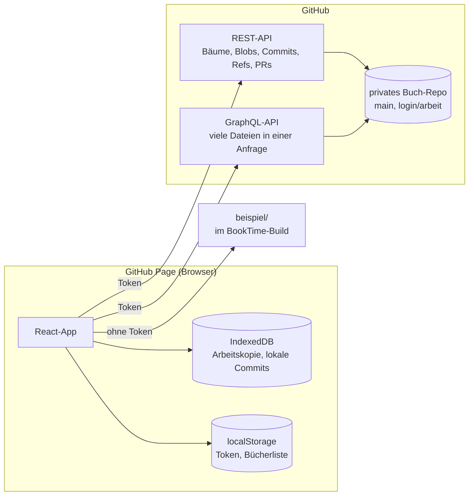
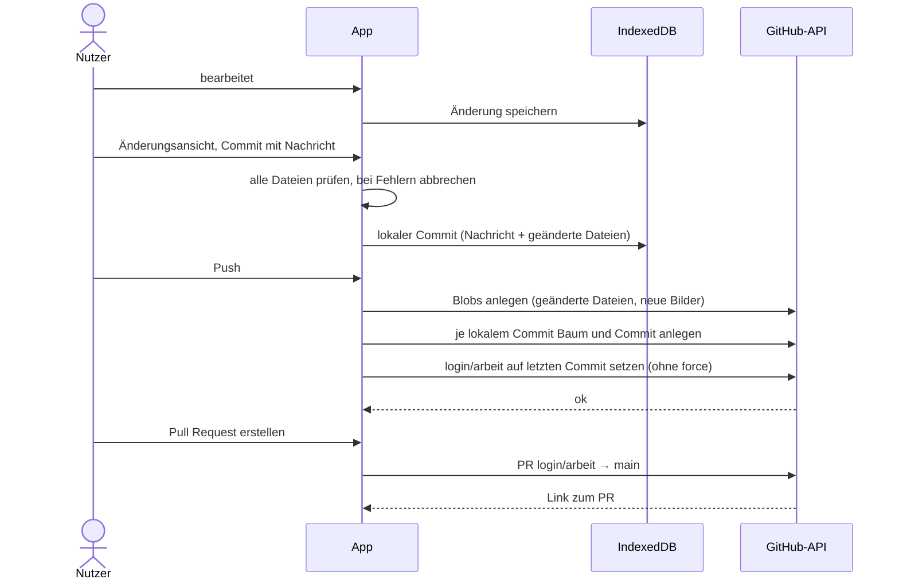

# Vorschlag: Speicherung in GitHub-Repos

Status: **akzeptiert (2026-10-25)**. Eine Datenbank ist vorerst zurückgestellt.

Ziel: Ein Buch ist ein Ordner aus lesbaren Dateien in einem privaten GitHub-Repo. BookTime bleibt eine
GitHub Page, lädt das Buch über die GitHub-API, bearbeitet eine Arbeitskopie im Browser und bietet eine
Änderungsansicht mit Commit, Push und Pull Request. Mitautoren sind Collaborators des Repos, die
Historie liefert git. Der Agent kann mit dem Format direkt arbeiten, ohne Zugang zu fremden Diensten.

## Festlegungen

| # | Festlegung | Begründung |
|---|---|---|
| 1 | **Ein privates GitHub-Repo pro Buch** | Mitautoren pro Buch über Collaborators, eigene Historie pro Buch, kein weiterer Anbieter |
| 2 | BookTime bleibt eine **Page**, Zugriff ausschließlich über die **GitHub-API** | Eine Webseite kann weder `git` starten noch den Git-Login des Rechners nutzen. `api.github.com` ist aus dem Browser erreichbar |
| 3 | Jeder Nutzer trägt ein **fine-grained Token** ein, nur für seine Buch-Repos | Kein Server für einen OAuth-Tausch nötig |
| 4 | Token **gemerkt bis Abmelden** | Bei jedem Start ein Token einzutragen wäre unpraktisch |
| 5 | **Arbeitskopie im Browser** (IndexedDB), automatisch gespeichert | Alle Browser, kein Klon nötig, nichts geht beim Schließen verloren |
| 6 | **Commit** sammelt Änderungen lokal, **Push** überträgt sie, **Pull Request** führt sie nach `main` | Entspricht dem gewohnten git-Ablauf |
| 7 | Jeder Nutzer arbeitet auf einem **eigenen Arbeitsbranch** `<github-login>/arbeit` | Mitautoren kommen sich nicht in die Quere, Konflikte zeigen sich im Pull Request |
| 8 | **Konflikte werden im Pull Request gelöst**, auf github.com | Keine eigene Merge-Oberfläche nötig |
| 9 | Nach dem Merge setzt die App den Arbeitsbranch **neu ab `main`** | Der nächste Pull Request startet vom gemeinsamen Stand |
| 10 | **Neu laden nur manuell** | Keine überraschenden Änderungen während der Arbeit |
| 11 | Bücher werden per **Repo-Adresse** (`owner/repo`) hinzugefügt, die Liste merkt sich der Browser | Das Token muss keine Repos auflisten |
| 12 | Neue Bücher: **Repo selbst auf github.com anlegen**, BookTime richtet den Ordner ein | Das Token braucht keine Verwaltungsrechte |
| 13 | **Eine Datei pro Element und Fakt**, Fakten in einem eigenen Ordner pro Art | Jede Änderung betrifft genau eine Datei, kleine Diffs, wenige Merge-Konflikte |
| 14 | Dateiname = **Name + kurze ID**, bei Namensänderung wird umbenannt | Lesbar im Explorer und in git, Verweise nutzen nur die ID und bleiben gültig |
| 15 | Struktur als **JSON**, Texte als **Markdown-Dateien daneben** | Saubere Diffs für Texte, keine neue Abhängigkeit |
| 16 | Fehlerhafte Dateien: **Rest laden, Fehler auflisten**, Commit erst ohne Fehler | Ein kaputter Merge sperrt nicht das ganze Buch, kaputte Daten kommen nicht zurück ins Repo |
| 17 | **Keine Größengrenze** für Bilder, **Repo-Größe wird angezeigt** | Der Nutzer entscheidet selbst, sieht aber, wann es eng wird |
| 18 | Beispielbuch als **Ordner im BookTime-Repo**, ohne Token nur lesbar | Zugleich Formatbeispiel und Testdaten, `src/sampleBook.ts` entfällt |
| 19 | Alles, was mit GitHub zu tun hat, liegt auf einer **eigenen Seite** `github.html`, getrennt von der Buchansicht | Die Buchansicht bleibt frei von Verwaltung |

## Architektur



- **Laden:** Ein Aufruf holt den Dateibaum des Arbeitsbranches (`git/trees?recursive=1`). Die Textdateien
  kommen gebündelt über GraphQL, bis zu 100 pro Anfrage. Ein Buch mit 2 000 Dateien braucht damit etwa
  20 Anfragen. Bilder lädt die App erst, wenn sie angezeigt werden, und behält sie in IndexedDB.
- **Arbeitskopie:** Pro Repo der geladene Stand mit Commit-SHA und alle Änderungen seitdem. Jede Änderung
  wird kurz danach dort gespeichert.
- **Auswertung:** Aus den Dateien entsteht das bestehende `Book`-Objekt. `model.ts` und die Szene bleiben
  unverändert.
- **Ohne Token** zeigt die App nur das Beispielbuch.

## Ordner

```text
mein-buch/
├── booktime.json                          Formatversion, Titel
├── booktime.note.md
├── time-points/
│   ├── ankunft-t1a2.json
│   └── markttag-t3b4.json
├── persons/
│   ├── anna-a3k9.json
│   ├── anna-a3k9.description.md
│   └── anna-a3k9.note.md
├── groups/
├── places/
│   ├── velmar-v7c1.json                    inkl. Phasen
│   └── taverne-zum-anker-k2d8.json
├── events/
│   ├── der-brief-e5f0.json
│   ├── der-brief-e5f0.description.md
│   └── der-brief-e5f0.result.md
├── relation-types/
│   └── liebt-r1x4.json
├── facts/
│   ├── stays/anna-taverne-zum-anker-s7c1.json
│   ├── journeys/ben-anker-ostfels-j2m5.json
│   ├── participations/anna-der-brief-p8q2.json
│   ├── memberships/kael-garde-m4n6.json
│   └── relations/anna-ben-l91d.json        inkl. Phasen
└── images/
    └── anna-i6w3.jpg
```

### Namen und IDs

| Regel | Festlegung |
|---|---|
| ID | 4 Zeichen aus `a–z` und `0–9`, zufällig, im ganzen Buch eindeutig (1,6 Mio. Möglichkeiten, bei Kollision neu würfeln). Unveränderlich |
| Verweise | Immer nur über die ID, z. B. `"place": "k2d8"` |
| Namensteil | Kleinbuchstaben, `ä → ae`, `ö → oe`, `ü → ue`, `ß → ss`, alles andere außer `a–z0–9` wird `-`, höchstens 40 Zeichen |
| Elemente | `<name>-<id>.json`, bei Events `<title>-<id>.json` |
| Fakten | Namen der Beteiligten in Modellreihenfolge, z. B. Aufenthalt `<person>-<ort>`, Reise `<person>-<von>-<nach>`, Beziehung `<from>-<to>` |
| Bilder | `images/<besitzer>-<bild-id>.<endung>`, Endung nach Dateityp |
| Umbenennen | Ändert sich ein Name, benennt die App alle Dateien um, deren Namensteil davon abhängt (Element, seine Texte, seine Bilder, Fakten mit ihm). Der Commit zeigt das als Umbenennung |

### Dateiinhalt

- JSON mit 2 Leerzeichen Einrückung, Felder in fester Reihenfolge wie im Datenmodell, Zeilenende LF und
  Leerzeile am Ende. So ändert eine Änderung nur die betroffenen Zeilen.
- Die Datei enthält ihre `id`. Passt sie nicht zum Dateinamen, ist das ein Fehler.
- **Texte einer Datei** (`description`, `note`, bei Events `result`, bei `booktime.json` `note`) stehen als
  `<datei>.<feld>.md` daneben. Fehlt die Datei, ist der Text leer.
- **Texte in verschachtelten Teilen** (Notizen von Orts- und Beziehungsphasen, Bildern) bleiben JSON-Strings.
  Sie sind meist kurz, und sonst entstünden sehr viele kleine Dateien.

Beispiel `persons/anna-a3k9.json`:

```json
{
  "id": "a3k9",
  "name": "Anna",
  "color": "#e07a5f",
  "existence": {},
  "images": [
    { "id": "i6w3", "file": "images/anna-i6w3.jpg", "order": 0 }
  ]
}
```

Beispiel `facts/relations/anna-ben-l91d.json`:

```json
{
  "id": "l91d",
  "from": "a3k9",
  "to": "b2c7",
  "phases": [
    { "id": "h3j8", "timing": { "to": "t3b4" }, "type": "r1x4", "strength": 4 },
    { "id": "h5k2", "timing": { "from": "t9z1" }, "type": "r6y2", "strength": 2, "causedBy": "e5f0", "note": "nach dem Brief" }
  ]
}
```

`booktime.json`:

```json
{
  "format": 1,
  "title": "Der Brief von Velmar"
}
```

`format` erlaubt spätere Formatänderungen. Die App liest nur Formate, die sie kennt, und sagt sonst, dass
eine neuere BookTime-Version nötig ist.

## Abläufe

### Commit, Push, Pull Request



- Der Push setzt den Branch **nie mit force**. Ist `login/arbeit` auf GitHub inzwischen weiter (z. B. von
  einem zweiten Gerät), pusht die App auf einen neuen Branch `login/arbeit-2` und bietet dafür einen eigenen
  Pull Request an. Es geht nichts verloren.
- Konflikte mit `main` zeigt GitHub im Pull Request, dort werden sie gelöst.

### Nach dem Merge

Beim Laden fragt die App, ob der Pull Request des Arbeitsbranches gemergt ist. Wenn ja und keine lokalen
Commits oder Änderungen offen sind, setzt sie `login/arbeit` auf den aktuellen Stand von `main` und lädt
neu. Sind lokale Änderungen offen, bleibt der Branch, und die App weist darauf hin.

### Neues Buch

1. Auf github.com ein leeres privates Repo anlegen und Mitautoren als Collaborators einladen.
2. In BookTime `owner/repo` eintragen. Ist das Repo leer, legt BookTime `booktime.json` an und committet
   das direkt auf `main`.

### Fehler beim Laden

| Fehler | Folge |
|---|---|
| Kein gültiges JSON, Pflichtfeld fehlt, falscher Typ | Datei wird übersprungen und mit Grund aufgelistet |
| `id` passt nicht zum Dateinamen, doppelte ID | beide Dateien übersprungen |
| Verweis auf eine unbekannte ID (auch in Phasen und Bildern) | Datei übersprungen, ebenso alles, was dadurch ins Leere zeigt |
| Unbekannte `format`-Version | Buch wird nicht geöffnet |

Die Prüfung ist eigener Code ohne neue Abhängigkeit. Solange Fehler bestehen, ist Bearbeiten möglich, aber
kein Commit. Behoben wird in der Datei selbst (auf github.com, im Editor oder vom Agenten), danach lädt man
neu.

## Token

| Einstellung | Wert |
|---|---|
| Art | fine-grained personal access token |
| Repositories | „Only select repositories“: die Buch-Repos |
| Rechte | Contents: Read and write, Pull requests: Read and write, Metadata: Read |
| Ablauf | nach Wahl auf github.com, die App meldet ein abgelaufenes Token |
| Ablage | `localStorage` dieser Seite, bis man sich abmeldet |

Die App prüft beim Laden, ob das Token Schreibrecht auf das Repo hat. Fehlt das Recht für Pull Requests, meldet das GitHub beim Erstellen.

### Content-Security-Policy

Als `<meta>`-Tag im Build: `script-src 'self'`, `connect-src https://api.github.com`, `img-src 'self' blob:
data:`, `object-src 'none'`, `base-uri 'none'`. `style-src` braucht `'unsafe-inline'` für Mantine. Damit
kann eingeschleuster Code das Token nicht an fremde Server schicken.

## Repo-Größe

Die App zeigt die Größe des Repos (`size` aus `GET /repos/{owner}/{repo}`) und die Größe der noch nicht
gepushten Bilder. Hinweise ab den Grenzen von GitHub: Repos ab 1 GB gelten als groß, einzelne Dateien ab
50 MB erzeugen eine Warnung, über 100 MB lehnt GitHub sie ab. Die App blockiert nichts, sie lehnt nur
Dateien über 100 MB ab, weil GitHub sie nicht annimmt.

## Beispielbuch

Der Ordner `beispiel/` im BookTime-Repo enthält das bisherige Beispielbuch im neuen Format. Die App bindet
ihn beim Build über `import.meta.glob` ein, er braucht also keinen Server und kein Token.
`src/sampleBook.ts` entfällt. `npm run check` prüft den Ordner mit derselben Prüfung wie beim Laden.

## Arbeit des Agenten

- Format, Prüfung und Beispielbuch liegen im BookTime-Repo, der Agent testet alles damit.
- Echte Buch-Repos fasst der Agent nicht an, außer du gibst ihm ausdrücklich eines.
- Für Tests der API-Anbindung genügt ein eigenes Test-Repo mit dem Beispielbuch.

## Grenzen und Risiken

- **GitHub kann mitlesen.** Private Repos sind nicht Ende-zu-Ende-verschlüsselt. GitHub ist ein
  US-Unternehmen.
- **Token im Browser:** Jede andere GitHub-Pages-Seite unter `tonsias.github.io` hat denselben Origin und
  käme an das Token. Ebenso jeder, der den BookTime-Code ändern kann. Das fine-grained Token begrenzt den
  Schaden auf die Buch-Repos.
- **API-Grenze:** 5 000 REST-Anfragen pro Stunde und Token. Laden und Push liegen weit darunter, ein Push mit
  vielen neuen Bildern braucht eine Anfrage pro Bild.
- **Arbeitskopie nur in diesem Browser:** Nicht gepushte Änderungen sind weg, wenn der Browser-Speicher
  gelöscht wird. Die App zeigt deshalb an, wie viel noch nicht gepusht ist.
- **Merge-Konflikte in JSON** löst man auf github.com von Hand. Eine Datei pro Element hält sie selten und
  klein.

## Verworfene Alternativen

| Alternative | Grund |
|---|---|
| Datenbank (Neon) | Vorerst zurückgestellt |
| Lokaler Klon über die File System Access API | Nur Chrome/Edge, und für Push und Pull Request bräuchte es trotzdem die API |
| Lokaler Helfer-Server oder Desktop-App mit `git` | BookTime soll eine Page bleiben |
| „Mit GitHub anmelden“ (OAuth) | Braucht einen zusätzlichen Server für den Token-Tausch |
| Token nur für die Sitzung oder mit Passwort verschlüsselt | Unpraktisch |
| Ein Repo für alle Bücher | Collaborators sähen alle Bücher |
| Direkt auf `main` committen / Branch pro PR | Mitautoren kämen sich in die Quere / mehr Branches ohne Nutzen |
| Konflikte in der App auflösen | Eigene Merge-Oberfläche, GitHub kann das schon |
| Automatisch neu laden | Nicht gewünscht |
| Bücher automatisch finden | Token müsste alle Repos lesen dürfen |
| BookTime legt Repos an | Token bräuchte Verwaltungsrechte für alle Repos |
| UUIDs oder nur Namen als Dateiname | Unlesbar bzw. nicht kollisionsfrei |
| Fakten bei den Elementen | Beziehungen gehören zu zwei Elementen |
| Nur JSON / Markdown mit YAML-Frontmatter | Texte als einzelne Zeile im Diff / neue Abhängigkeit |
| Bilder verkleinern oder begrenzen | Nicht gewünscht |
| Buch bei Fehlern nicht öffnen oder nur lesbar | Ein kaputter Merge würde die Arbeit blockieren |
| Beispielbuch als TypeScript oder eigenes Repo | Kein Formatbeispiel bzw. bräuchte ein Token |

## Nicht Teil dieses Vorschlags

Die Gestaltung der GitHub-Seite ist vorerst schlicht. Ihre Oberfläche und das Bearbeiten selbst sind
UI-Entscheidungen und kommen als eigener HTML-Prototyp. Bis es einen Editor gibt, entstehen Änderungen nur
außerhalb der App, und das Hochladen neuer Bilder ist noch nicht nötig.
