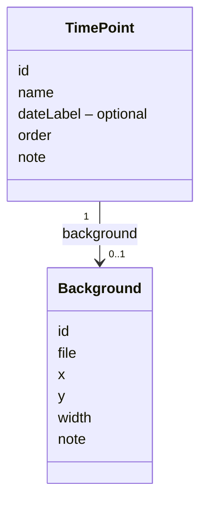
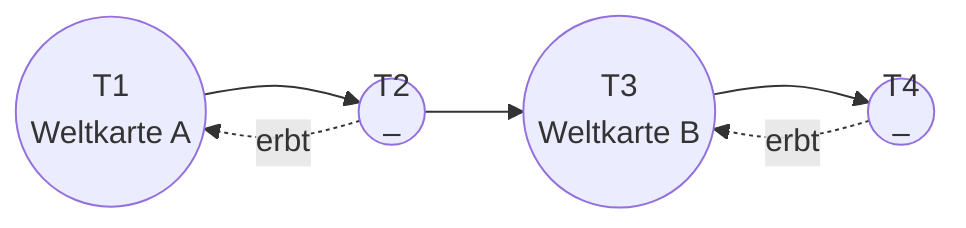

# Vorschlag: Hintergrundbild für Zeitpunkte

Status: **akzeptiert (2026-10-25)**. Erweitert `docs/2026-10-datenmodell.md` und `docs/2026-10-speicherung-github.md`.

Ziel: Ein Zeitpunkt kann ein Hintergrundbild halten, zum Beispiel eine Weltkarte. Die Karte liegt in der
3D-Szene unter dem Netz und passt zu den Koordinaten der Orte.

## Festlegungen

| # | Festlegung | Begründung |
|---|---|---|
| 1 | Ein Zeitpunkt hat **höchstens einen** Hintergrund (`background`, optional) | Ein Hintergrund ist immer genau ein Bild |
| 2 | Ein Hintergrund **gilt weiter**, bis ein späterer Zeitpunkt einen eigenen setzt | Eine Weltkarte muss nicht an jeden Zeitpunkt gehängt werden |
| 3 | Ein Hintergrund lässt sich **nur ersetzen**, nicht beenden | Ausdrücklich so gewünscht |
| 4 | Lage in **Weltkoordinaten**: Mittelpunkt `x`, `y` und Breite `width`, die Höhe ergibt sich aus dem Seitenverhältnis des Bildes | Orte liegen genau an ihrer Stelle auf der Karte, das Bild wird nie verzerrt |
| 5 | Anzeige **auf jeder Zeitebene**, in der Raum-Ansicht die aktuelle Ebene deutlich, die übrigen blass, in der Netz-Ansicht hinter dem aktuellen Netz | Die Karte zeigt, wo das Netz liegt, ohne die anderen Ebenen zu überdecken |
| 6 | **Feste, gedämpfte Deckkraft** für alle Hintergründe | Netz und Beschriftungen bleiben lesbar, nichts einzustellen |
| 7 | Das Beispielbuch bekommt eine **schlichte SVG-Karte** passend zu seinen Orten | Zeigt die Funktion und dient als Test |

## Modell



Welcher Hintergrund zu einem Zeitpunkt gilt: der eigene, sonst der des nächsten früheren Zeitpunkts, der
einen hat. Gibt es keinen, bleibt die Ebene leer. Das berechnet eine neue Funktion `backgroundAt(book, i)`
in `src/model.ts`.



## Dateiformat

Der Hintergrund steht in der Datei des Zeitpunkts, das Bild liegt wie alle Bilder unter `images/` mit dem
Namen des Zeitpunkts und der ID des Hintergrunds.

`time-points/ankunft-in-velmar-eq81.json`:

```json
{
  "id": "eq81",
  "name": "Ankunft in Velmar",
  "dateLabel": "Frühling, Jahr 412",
  "order": 1,
  "background": { "id": "w4k2", "file": "images/ankunft-in-velmar-w4k2.svg", "x": 0, "y": 0, "width": 24 }
}
```

Die Prüfung beim Laden kennt das neue Feld. `width` muss größer als 0 sein. Erlaubt sind dieselben
Bildformate wie für andere Bilder, dazu SVG.

## Anzeige

- In der Raum-Ansicht liegt auf jeder Zeitebene der dort gültige Hintergrund, die aktuelle Ebene deutlich,
  die übrigen blass. Folgen mehrere Ebenen mit demselben geerbten Bild, zeigt jede es.
- In der Netz-Ansicht liegt der Hintergrund des aktuellen Zeitpunkts hinter dem Netz.
- In der Zeit-Ansicht (Seitenansicht) sind die Ebenen nur Linien, dort ist kein Hintergrund sichtbar.
- Bilder aus einem GitHub-Repo werden wie alle anderen erst geladen, wenn sie gebraucht werden.

## Verworfene Alternativen

| Alternative | Grund |
|---|---|
| Mehrere Hintergründe pro Zeitpunkt | Nicht gebraucht |
| Hintergrund nur für den eigenen Zeitpunkt | Die gleiche Karte müsste an jeden Zeitpunkt |
| Buch-Standard mit Ausnahmen | Mit dem Weitergeben bis zum Ersetzen nicht nötig |
| Hintergrund explizit beenden | Nicht gewünscht |
| Automatisch über alle Orte strecken | Lage auf der Karte stimmt nur ungefähr |
| Nur auf der aktuellen Ebene anzeigen | Der Raum verliert die Orientierung über die Zeit |
| Deckkraft pro Bild | Unnötige Einstellung |
| Höhe als eigene Angabe | Könnte das Bild verzerren |
