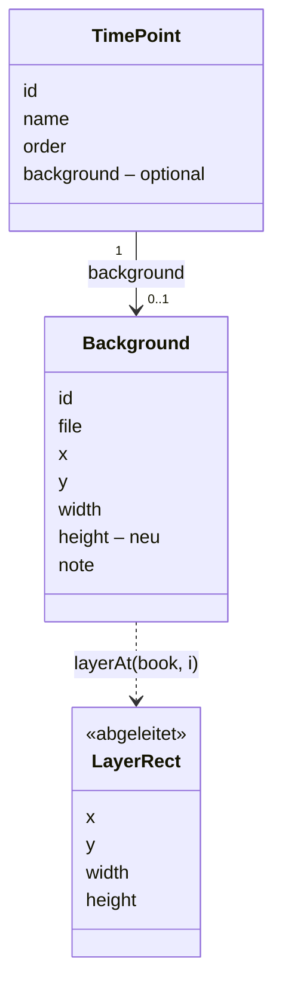
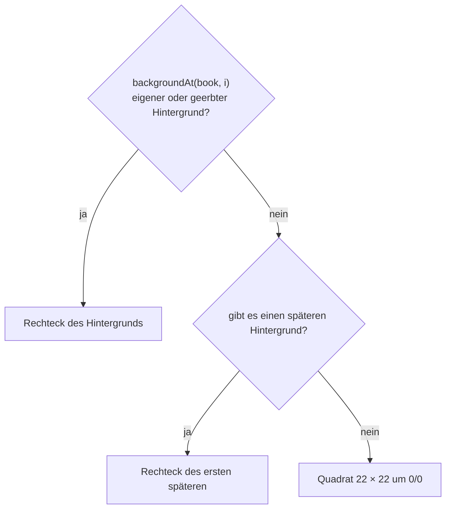
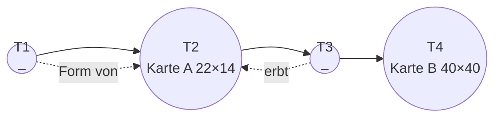
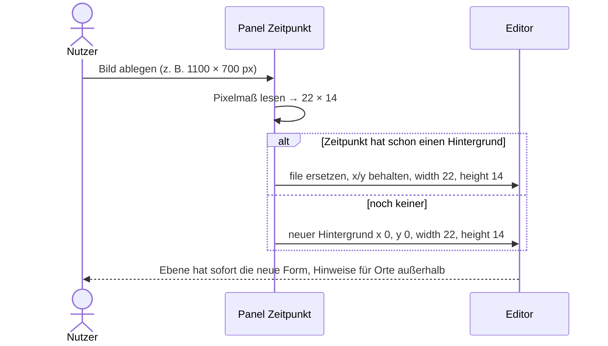

# Vorschlag: Zeitebene übernimmt Form und Größe ihres Hintergrundbilds (Issue #4)

Status: **akzeptiert (2026-11-08)**. Ändert `docs/2026-10-zeitpunkt-hintergrund.md` (Festlegung 4) und
ergänzt die Hinweise aus `docs/2026-10-datenmodell.md` (Festlegung 14).

Ziel: Eine Zeitebene ist kein festes Quadrat mehr, sondern genau so groß und so geformt wie ihr
Hintergrundbild. Elemente lassen sich auf der ganzen Bildfläche ablegen.

Prototyp: `2026-11-ebene-nach-bild.html`

## Umsetzungsstand (2026-11-08)

Alle Festlegungen sind umgesetzt. Ergänzung bei der Umsetzung: Der Hinweis hat als zweite Lösung
„Ort löschen“. Er erscheint nur in Büchern mit mindestens einem Hintergrund, denn ohne Bild bleibt das
Standardquadrat wie bisher.

## Festlegungen

| # | Festlegung | Begründung |
|---|---|---|
| 1 | Die **Fläche einer Ebene** ist das Rechteck ihres gültigen Hintergrunds: Mittelpunkt `x`, `y`, Breite `width`, Höhe `height` | Die Ebene folgt immer dem Bild, eine eigene Größeneinstellung gibt es nicht |
| 2 | Ein **geerbter Hintergrund** gibt auch seine Form weiter | Die Ebene zeigt das geerbte Bild, also hat sie auch dessen Form |
| 3 | Ebenen **vor dem ersten Hintergrund** übernehmen die Form des ersten späteren Hintergrunds | Alle Ebenen einer Geschichte passen zur selben Karte, auch vor ihrem ersten Auftreten |
| 4 | Ein Buch **ganz ohne Hintergrund** behält das Quadrat 22 × 22 um 0/0 | Bestehende Bücher ohne Bild sehen unverändert aus |
| 5 | Neues Feld **`height`** im Hintergrund, beim Hochladen gesetzt | Prüfung, Doppelklick und Szene kennen die Fläche, ohne das Bild zu laden. Prüfungen bleiben rein dateibasiert |
| 6 | **Größe beim Hochladen nach Pixeln: 50 px = 1 Einheit**, Mitte 0/0. Ein 1100 × 700-Bild wird 22 × 14 | Große Bilder haben mehr Platz. Die alte Beispielkarte (1100 px) behält ihre Größe |
| 7 | **Ersetzen** eines Bildes behält den Mittelpunkt und setzt Breite und Höhe neu nach Pixeln | Das neue Bild wird nie verzerrt, die Karte bleibt an ihrer Stelle |
| 8 | Hat ein Bild **kein Pixelmaß** (SVG ohne `width`/`height`), gilt die Breite 22 und die Höhe nach `viewBox`, ohne `viewBox` 22 | Jedes Bild bekommt eine sinnvolle Startgröße |
| 9 | Die Felder **X, Y und Breite** bleiben im Panel. Eine Änderung der Breite skaliert die Höhe mit | So lässt sich eine Karte an gesetzte Orte anpassen, ohne sie zu verzerren |
| 10 | **Alte Dateien ohne `height`:** Der Editor misst das Bild beim Öffnen einmal und ergänzt `height` als ungespeicherte Änderung („Höhe des Hintergrunds ergänzt“). Bis dahin gilt `height = width` | Kein manueller Schritt nötig, die Änderung ist sichtbar und lässt sich rückgängig machen |
| 11 | **Raum-Ansicht:** Jede Ebene hat ihre eigene Form an ihrer Stelle. Die Beschriftung sitzt mittig über der Oberkante | Man sieht direkt, wo sich die Karte ändert |
| 12 | **Netz-Ansicht:** Die Kamera schaut auf die Mitte der aktuellen Ebene, mit einem Abstand, bei dem die ganze Ebene sichtbar ist | Große oder verschobene Karten sind sonst nur teilweise zu sehen |
| 13 | **Ablegen und Anlegen per Doppelklick** gehen auf der ganzen Fläche der aktuellen Ebene | „Elemente auf der ganzen Bildfläche ablegen“ |
| 14 | **Orte außerhalb der Fläche** bleiben, wo sie sind. Neuer Hinweis `outside-layer` mit der Lösung „Auf den Rand der Ebene verschieben“ | Nichts wird ungefragt verschoben, aber der Fehler fällt auf |
| 15 | Das **Beispielbuch** bekommt `"height": 22` | Das Beispiel zeigt das neue Feld und bleibt beim Zurückschreiben unverändert |

### Verworfene Alternativen

- **Quadrat für geerbte Hintergründe:** Das Bild würde wieder über die Ebene ragen, das Problem des Issues bliebe.
- **Quadrat vor dem ersten Bild:** Die ersten Ebenen sähen anders aus als alle folgenden, obwohl dieselbe Welt gemeint ist.
- **Startgröße „Breite 22“ oder „längste Seite 22“:** Die Größe hinge nicht vom Bild ab. Gewählt ist die Pixelgröße.
- **Seitenverhältnis nur aus dem Bild messen:** Hinweise und Doppelklick hingen davon ab, ob die Bilder schon geladen sind.
- **Nur Breite oder gar keine Felder:** Eine Karte ließe sich nicht an bereits gesetzte Orte anpassen.
- **Gemeinsamer Rahmen um alle Ebenen:** Er versteckt, dass sich die Karte zwischen Zeitpunkten ändert.
- **Orte automatisch an den Rand setzen:** Das verschiebt Orte ungefragt und kann gewollte Lagen zerstören.
- **Eigenes Feld für die Höhe im Panel:** Damit ließe sich das Bild verzerren.

## Modell



`layerAt(book, i)` in `src/model.ts` ersetzt die Konstante `LAYER_SIZE` überall, wo die Fläche gebraucht wird
(Szene, Doppelklick, Hinweis):





## Dateiformat

`time-points/ankunft-in-velmar-eq81.json`:

```json
"background": { "id": "w4k2", "file": "images/ankunft-in-velmar-w4k2.svg", "x": 0, "y": 0, "width": 22, "height": 22 }
```

`height` ist in der Datei optional (alte Bücher), muss aber größer als 0 sein, wenn es vorhanden ist.

## Hochladen



## Hinweis „Ort außerhalb der Ebene“

- Regel `outside-layer`, je Ortsphase einmal, am ersten Zeitpunkt, an dem die Weltposition des Ortes außerhalb
  von `layerAt` liegt. Text: „Velmar liegt auf 3. Das Konzil außerhalb der Ebene“.
- Lösung „Auf den Rand der Ebene verschieben“: Die Weltposition wird auf das Rechteck begrenzt, bei Unterorten
  relativ zum Elternort umgerechnet. Liegt der Ort an einem späteren Zeitpunkt wieder außerhalb, erscheint der
  Hinweis dort neu.
- Zweite Lösung „Ort löschen“, wie das Löschen im Editor.
- Wie jeder Hinweis lässt er sich als gewollt markieren.
- Nicht betroffen ist das Ziehen eines Ortes: Er darf beim Ziehen über den Rand hinaus, der Hinweis erscheint dann.

## Umsetzung

| Datei | Änderung |
|---|---|
| `src/model.ts` | `Background.height?`, `layerAt(book, i)` |
| `src/storage/` | `height` lesen, prüfen und schreiben |
| `src/checks.ts` | Hinweis `outside-layer` |
| `src/edit/fixes.ts` | Lösung „Auf den Rand der Ebene verschieben“ |
| `src/ui/panel/OtherPanels.tsx` | Pixelmaß beim Hochladen, Breite skaliert Höhe |
| `src/edit/useEditor.ts` | `height` für alte Dateien einmalig ergänzen |
| `src/scene/Scene.tsx` | `Layer` und `Backdrop` aus `layerAt`, Beschriftung an der Oberkante, Kamera der Netz-Ansicht |
| `src/scene/Gestures.tsx` | Doppelklick auf der ganzen Fläche |
| `src/scene/layout.ts` | `LAYER_SIZE` entfällt, die Vorgabe ist `DEFAULT_LAYER` in `src/model.ts` |
| `beispiel/` | `"height": 22` |
| Tests | `layerAt`, Hinweis und Lösung, Dateiformat; E2E: Hochladen eines Querformats ändert die Ebene |
