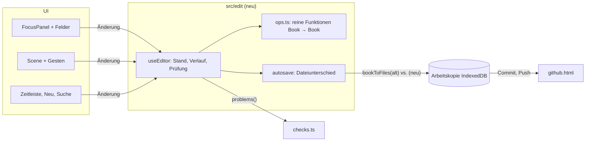
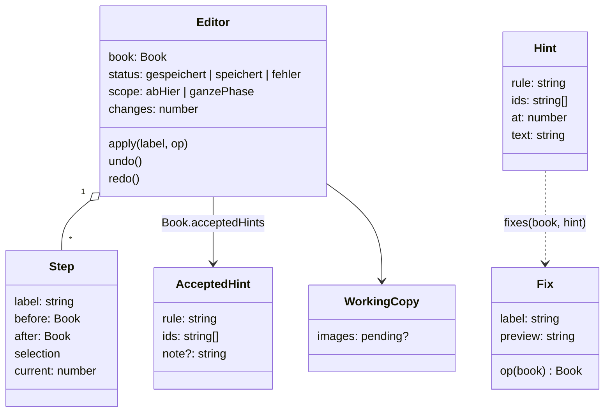
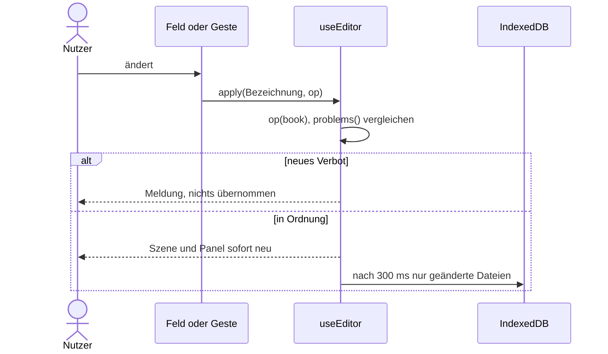

# Vorschlag: Editor – alles bearbeitbar

Status: **akzeptiert (2026-11-07)**. Prototyp: [2026-11-editor.html](2026-11-editor.html)

## Umsetzungsstand (2026-11-07)

Alle Festlegungen sind umgesetzt. Abweichungen im Detail:

| Festlegung | Stand |
|---|---|
| 10 Markdown-Texte | `Strg+Enter` übernimmt, Enter macht eine neue Zeile |
| 13 Speicherstand | zusätzlich zeigt die Werkzeugleiste die Zahl offener Änderungen |
| 17 Zeitspannen-Regler | Mantine-RangeSlider, bedienbar mit Maus und Pfeiltasten |
| 20 Ort ziehen | angefasst wird am Ring, damit sich die Kamera im Inneren frei drehen lässt |
| 58 Trefferlogik | aufgeteilt in `hitAt` und `describeDrop` (`src/scene/hits.ts`) |
| Tests | 114 Unit- und Komponententests (Vitest, Testing Library), 25 Ende-zu-Ende-Tests (Playwright mit WebGL), davon 7 zu den Befunden eines Reviews aus Nutzersicht |

Zwei Events am selben Ort zum selben Zeitpunkt liegen in der Szene übereinander; man wählt sie über Suche oder Panel.

Ziel: Alles, was das Datenmodell kennt, lässt sich direkt in der App bearbeiten, ohne Modus, ohne Speichern-Knopf
und ohne Szene und Zeitkontext zu verlassen. Hinweise lassen sich in einem Dialog auflösen oder als gewollt markieren.
Das Dateiformat bekommt dafür nur eine neue, optionale Datei.

## Festlegungen aus der Rückfrage

| # | Festlegung | Begründung |
|---|---|---|
| 1 | **Immer direkt bearbeitbar**, kein Modus, automatisch gespeichert | Jeder Zusatzschritt bremst; Fehler fängt Rückgängig ab |
| 2 | **Szene und Panel**: auf der aktuellen Ebene ziehen, alles auch im Panel | Das Netz fühlt sich direkt an, das Panel bleibt der vollständige und tastaturbedienbare Weg |
| 3 | **Standard „ab hier“**: Zeitlich veränderliche Werte teilen die Phase am aktuellen Zeitpunkt, ein Umschalter ändert die ganze Phase | Entspricht der Kernidee eines Netzes, das sich entlang der Zeit verändert |
| 4 | **Beispielbuch als lokale Arbeitskopie** mit „Zurücksetzen“ | Bearbeiten funktioniert ohne Token, und alles ist ohne GitHub testbar |
| 5 | **Löschen**: ohne Abhängigkeiten sofort, mit Abhängigkeiten Dialog mit Liste | Man sieht vorher, was mitgeht |
| 6 | **Rückgängig bis zum Neuladen**, nur im Speicher | Die Änderungen selbst bleiben erhalten, Älteres liefert Git |
| 7 | **Änderungszähler** in der Werkzeugleiste, Commit und Push bleiben auf `github.html` | Klare Trennung, Sync-Ablauf bleibt wie akzeptiert |
| 8 | **Playwright und Testing Library**, neuer Check `check:e2e` | Auch das Ziehen in der WebGL-Szene ist dauerhaft abgesichert |

## Festlegungen zur Bedienung

### Grundregeln

| # | Festlegung | Begründung |
|---|---|---|
| 9 | Feld zeigt beim Überfahren einen feinen Rahmen, Klick macht es editierbar. **Enter oder Verlassen übernimmt, Esc verwirft**, Tab geht zum nächsten Feld | Gleiches Verhalten überall, Lesen bleibt ruhig |
| 10 | Markdown-Texte: Klick zeigt ein mitwachsendes Textfeld, beim Verlassen wieder die formatierte Ansicht | Keine neue Abhängigkeit, kein Wechsel zwischen Lesen und Bearbeiten |
| 11 | Jede Änderung ist **ein** Rückgängig-Schritt: ein Feld beim Übernehmen, ein Ziehen beim Loslassen | Vorhersagbar, Tippen erzeugt keine Einzelschritte |
| 12 | Rückgängig springt zum Zeitpunkt und zur Auswahl der Änderung und nennt sie in einer Meldung | Man sieht, was gerade zurückgenommen wurde |
| 13 | Werkzeugleiste zeigt „Gespeichert“ oder „Speichert …“, einen Fehler dauerhaft in Rot | Vertrauen ohne Speichern-Knopf; Datenverlust darf nie still passieren |

### Zeit

| # | Festlegung | Begründung |
|---|---|---|
| 14 | Der Umschalter **Ab hier / Ganze Phase** sitzt in der Zeitleiste und gilt für Szene und Panel. Er steht nach dem Laden auf „Ab hier“ | Ein Ort, ein Begriff, immer sichtbar |
| 15 | Zeitunabhängiges (Name, Farbe, Beschreibung) ändert sich immer überall. „Ab hier“ gilt nur für Beziehungsart und -stärke, Ortslage und Elternort sowie den Ort eines Aufenthalts | Nur diese Werte sind im Modell zeitlich |
| 16 | Steht man am Anfang einer Phase oder gilt sie nur einen Zeitpunkt, wird nichts geteilt | Teilen würde eine leere Phase erzeugen |
| 17 | Zeitangaben bearbeitet ein **Zeitspannen-Regler** mit zwei Griffen auf den Zeitpunkten. Ein Griff ganz außen heißt „von Anfang“ bzw. „bis Ende“, beide Griffe auf einem Punkt heißen `at` | Sichtbar statt zwei Auswahllisten; deckt alle drei Formen von `Timing` ab |
| 18 | Beim Teilen behält der alte Teil `causedBy` und `note`, der neue Teil startet ohne beides. Bilder einer Ortsphase werden kopiert, zeitlich begrenzte gehen an die passende Phase | Der Grund der alten Phase gilt nicht für die neue, das Bild soll nicht verschwinden |
| 19 | Nach jeder Änderung werden **direkt aufeinanderfolgende Phasen mit gleichem Wert zusammengeführt** (Aufenthalte am selben Ort, Beziehungsphasen mit gleicher Art und Stärke, Ortsphasen mit gleicher Lage) | Wer A erst ab 5 nach Ostfels zieht und dann ab 2, soll einen Aufenthalt haben, nicht zwei |

### Szene

| # | Geste | Ergebnis |
|---|---|---|
| 20 | Ort ziehen | Neue Lage, Kinder wandern mit |
| 21 | Person auf Ort ziehen | Aufenthalt ab hier; der bisherige endet einen Zeitpunkt vorher |
| 22 | Person auf Person ziehen | Kleines Menü wählt die Beziehungsart, Stärke 3, gilt ab hier. **Gerichtet heißt immer: von der gezogenen zur Zielperson** |
| 23 | Person auf Event ziehen | Teilnahme |
| 24 | Doppelklick auf leere Ebene | Neuer Ort an dieser Stelle, Name direkt im Panel editierbar |

Ziehen geht in den Ansichten Raum und Netz auf der aktuellen Ebene. In der Ansicht Zeit nicht, weil man dort
seitlich auf die Ebenen schaut. Beim Ziehen zeigt ein Gummiband das Ziel und ein Etikett am Zeiger das Ergebnis,
etwa „Anna → Velmar: Aufenthalt ab 5“. Loslassen im Leeren tut nichts. Die Kamera bewegt sich nur, wenn man nicht
auf einem Element ansetzt.

| # | Festlegung | Begründung |
|---|---|---|
| 25 | **Richtung beim Ziehen**: Geändert wird die Beziehung *in Zugrichtung*, also A → B oder eine ungerichtete zwischen beiden. Ist sie andersherum gespeichert und die neue Art gerichtet, endet sie ab hier und eine neue Beziehung A → B beginnt. Eine gerichtete Beziehung B → A bleibt unberührt | Die Geste legt die Richtung fest, ohne Nachfrage. B → A ist ein eigenes Gefühl (Mira misstraut Kael, Kael liebt Mira) und darf nicht überschrieben werden |
| 26 | Etikett am Zeiger und Menü zeigen die Richtung: „Anna → Kael“ bei gerichteten, „Anna ↔ Kael“ bei ungerichteten Arten. Dasselbe gilt für „+ Verknüpfung → Beziehung“ im Panel: von der ausgewählten Person zur gewählten | Man sieht vor dem Loslassen, was entsteht |
| 27 | **Leiste „Ohne Ort“** über der Zeitleiste: Personen ohne Position und Events ohne Ort auf dieser Ebene als ziehbare Chips | Neue Personen hätten sonst keine sichtbare Kugel zum Anfassen |

### Anlegen

| # | Festlegung | Begründung |
|---|---|---|
| 28 | Knopf **Neu** (Taste `N`) legt Person, Gruppe, Ort, Event oder Zeitpunkt sofort an und fokussiert den markierten Namen | Kein Formular: tippen, Enter, fertig |
| 29 | Die Suche (Strg+K) bietet bei unbekanntem Text „„Xy“ als Person anlegen“ und die übrigen Arten an | Suchen und Anlegen sind derselbe Gedanke |
| 30 | Alle Verweisfelder sind Suchlisten mit „Neu anlegen“ | Man verlässt die Stelle nicht, um einen Ort nachzutragen |
| 31 | Farbe kommt aus einer Palette: die erste noch nicht benutzte | Festlegung 15 des Datenmodells |
| 32 | Neue Personen und Orte existieren immer, neue Events gelten zum aktuellen Zeitpunkt, neue Zeitpunkte kommen direkt nach dem aktuellen | Sinnvollste Annahme ohne Rückfrage |

### Panel

| # | Festlegung | Begründung |
|---|---|---|
| 33 | Das Fokus-Panel wird zum Editor für Person, Gruppe, Ort, Event, **Zeitpunkt, Beziehungsart und Buch** | Ein Ort für alles, kein zweites Bedienkonzept |
| 34 | Zeitpunkt: Klick auf den Namen in der Zeitleiste. Beziehungsart: Klick in der Legende. Buch: Klick auf den Titel | Man klickt auf das, was man ändern will |
| 35 | Fakt-Zeilen klappen beim Klick auf und zeigen alle Felder. **+ Verknüpfung** legt Aufenthalt, Reise, Beziehung, Mitgliedschaft oder Teilnahme an | Lesen bleibt kompakt, Details sind einen Klick entfernt |
| 36 | Buch-Panel: Titel, Notiz, Zeitpunkte per Ziehen sortieren, Beziehungsarten, beim Beispielbuch „Zurücksetzen“ | Sortieren braucht die Übersicht aller Zeitpunkte |
| 37 | Bilder: Ablegen, Einfügen (Strg+V) oder Auswählen, Reihenfolge per Ziehen, je Bild Zeitspanne und Notiz. Keine Verkleinerung | Festlegung der Speicherung |
| 38 | Hintergrund im Zeitpunkt-Panel: Bild, X, Y, Breite mit Live-Vorschau | Selten gebraucht, Ziehen in der Szene lohnt nicht |

### Tastatur

`N` Neu · `F2` Name · `Entf` Löschen · `Strg+Z` / `Strg+Y` Rückgängig/Wiederholen · `←` `→` Zeitpunkt wechseln ·
`Esc` Feld verwerfen, sonst Auswahl aufheben. In Textfeldern gilt das Rückgängig des Browsers.

## Festlegungen zur Prüfung und zum Löschen

**Verbote** (Festlegung 14 des Datenmodells) werden jetzt beim Bearbeiten verhindert: Jede Änderung läuft durch
`problems()`. Entsteht ein neues Problem, wird sie nicht übernommen, und eine Meldung nennt den Grund.
**Hinweise** blockieren nie und aktualisieren sich sofort.

| Gelöscht | Geht mit | Bleibt, angepasst |
|---|---|---|
| Person | Aufenthalte, Reisen, Mitgliedschaften, Teilnahmen, Beziehungen | |
| Gruppe | Mitgliedschaften, Teilnahmen, Beziehungen | |
| Ort | Aufenthalte, Reisen | Events verlieren den Ort; Unterorte verlieren den Elternort und behalten ihre Weltposition |
| Event | Teilnahmen | `causedBy` wird entfernt |
| Beziehungsart | Phasen dieser Art, Beziehungen ohne Phase | |
| Zeitpunkt | Fakten und Events mit `at`, die nur dort gelten | `from`/`to` rücken auf den Nachbarn. Der letzte Zeitpunkt lässt sich nicht löschen |
| Bild | | Die Datei wird entfernt, wenn nichts mehr auf sie verweist |

## Hinweise auflösen

Hinweise (erlaubte Widersprüche nach Festlegung 14 des Datenmodells) bekommen einen **Auflöse-Dialog**.

| # | Festlegung | Begründung |
|---|---|---|
| 39 | Ein Klick auf einen Hinweis (Liste in der Werkzeugleiste oder im Panel) öffnet den Dialog. „N Hinweise“ in der Werkzeugleiste startet beim frühesten | Ein Weg für alle Hinweise |
| 40 | Der Dialog ist **schwebend, ohne Abdunkeln**, links oben über der Werkzeugleiste, die man beim Auflösen nicht braucht. Szene und Zeitpunkt springen zum Hinweis, die beteiligten Elemente sind hervorgehoben | Man muss das Problem in der Szene sehen können, um es zu entscheiden |
| 41 | Inhalt: „Hinweis 2 von 7“, der Satz mit klickbaren Namen, ein **Mini-Zeitstrahl** mit den widersprüchlichen Zeitspannen (Überschneidung rot), darunter 2–3 **Lösungen als Karten** mit Vorschau des Ergebnisses | Die Vorschau zeigt die Folge einer Lösung vor dem Klick |
| 42 | Tasten `1`–`3` wählen eine Lösung, `S` überspringt, `G` markiert als gewollt, `Esc` schließt | Viele Hinweise lassen sich schnell abarbeiten |
| 43 | Jede Lösung ist **ein Rückgängig-Schritt** mit Meldung. Danach zeigt der Dialog den nächsten Hinweis, nach dem letzten „Alle Hinweise erledigt“ | Fluss ohne erneutes Öffnen |
| 44 | **Selbst bearbeiten** schließt den Dialog, wählt das Element und klappt den betroffenen Fakt im Panel auf | Für Fälle, die keine vorgefertigte Lösung trifft |
| 45 | **Als gewollt markieren** mit optionaler Begründung. Der Hinweis verschwindet für alle Mitautoren. Im Buch-Panel listet „Als gewollt markiert“ diese Hinweise, „Wieder anzeigen“ hebt die Markierung auf | Festlegung 14 erlaubt bewusste Widersprüche, sie sollen nicht dauerhaft stören |
| 46 | Hinweistexte nennen den konkreten Fakt mit Zeitspanne, z. B. „Aufenthalt in Kloster Sankt Ilm (bis 2) liegt außerhalb der Existenz von Ilya (2–5)“ | Zwei gleich lautende Hinweise waren nicht unterscheidbar |

### Lösungen je Hinweis

| Hinweis | Lösungen |
|---|---|
| Person gleichzeitig an mehreren Orten oder unterwegs | Früheren Aufenthalt vor dem späteren enden lassen · Späteren erst nach dem früheren beginnen lassen · Einen davon entfernen |
| Fakt liegt außerhalb der Existenz | Existenz erweitern · Fakt auf die Existenz kürzen (nur wenn sie sich überschneiden) · Fakt entfernen |
| Beginnt vor dem auslösenden Event | Beginn auf das Event legen · Auslöser entfernen |
| Teilnahme außerhalb der Event-Zeit | Eigene Zeit entfernen, die Event-Zeit gilt · Event-Zeit erweitern |
| Person ist beim Event, aber woanders | Während des Events am Event-Ort, davor und danach wie bisher · Teilnahme entfernen |
| Event an einem Ort, der nicht existiert | Existenz des Ortes erweitern · Event ohne Ort |
| Zwei gleiche ungerichtete Beziehungen überschneiden sich | Zu einer Beziehung zusammenführen · Spätere nach der früheren beginnen lassen |
| Ort hat zu dieser Zeit keine Lage | Vorherige Lage bis zur Lücke verlängern · Existenz kürzen |
| Ort liegt in einem Ort, der nicht existiert | Existenz des Elternorts erweitern · Elternort entfernen, Weltposition bleibt |
| Unterort außerhalb des Radius | Radius des Elternorts vergrößern · Unterort an den Rand rücken |
| Bild gilt außerhalb der Existenz oder Orts-Phase | Bildzeit anpassen · Bildzeit entfernen |
| Bild oder Hintergrund fehlt im Repo | Bild neu hochladen · Verweis entfernen |

### Datei für gewollte Hinweise

`accepted-hints.json` im Wurzelordner des Buchs; sie fehlt, solange nichts markiert ist:

```json
{
  "accepted": [
    { "rule": "outside-existence", "ids": ["nq4n", "ilya"], "note": "Ilya ist als Geist im Kloster" }
  ]
}
```

| # | Festlegung | Begründung |
|---|---|---|
| 47 | Ein Hinweis wird über **Regel und beteiligte IDs** erkannt (`rule` + `ids`), nicht über Text oder Zeitpunkt | Bleibt stabil, wenn sich Namen oder Zeitspannen ändern |
| 48 | Einträge mit unbekannten IDs werden beim Laden ignoriert und beim nächsten Speichern entfernt, ohne Ladefehler | Nach dem Löschen eines Elements wäre ein Ladefehler nur lästig |
| 49 | Keine neue Formatversion: Ältere BookTime-Versionen ignorieren unbekannte Dateien im Wurzelordner bereits | Kein Zwang zum Aktualisieren für Mitautoren |
| 50 | Das Datenmodell bekommt `Book.acceptedHints` und `Hint.rule`; das Dokument zum Datenmodell wird bei Festlegung 14 ergänzt | Der Hinweis braucht eine stabile Art, die Lösungen eine Zuordnung |

## Architektur







| # | Festlegung | Begründung |
|---|---|---|
| 51 | Neuer Ordner `src/edit/` mit **reinen Funktionen** `Book → Book` | Bücher sind unveränderlich, die Caches im Modell bleiben gültig, alles ist ohne Browser testbar |
| 52 | State bleibt React: ein Hook `useEditor`, keine Bibliothek | Ein einziger Stand, kein Bedarf für mehr |
| 53 | Verlauf speichert **Buch-Stände**, nicht Gegenoperationen | Strukturelle Teilung macht das billig, Rückgängig kann nie falsch rechnen |
| 54 | Gespeichert wird der **Unterschied** von `bookToFiles(vorher)` zu `bookToFiles(nachher)` auf `copy.files` | Dateien, die beim Laden fehlerhaft waren, bleiben erhalten; Umbenennen (Festlegung 14 der Speicherung) ergibt sich von selbst |
| 55 | Beispielbuch: Arbeitskopie unter dem Schlüssel `beispiel`. Kommt eine neue Beispiel-Version und gibt es keine Änderungen, wird sie übernommen | Gleicher Code wie echte Bücher |
| 56 | Neue Bilder: Git-SHA im Browser berechnen, im `imageCache` ablegen, in `images` mit `pending` markieren. Der Push legt ihre Blobs an. `github.html` zeigt ihre Größe (Festlegung 17 der Speicherung) | Der vorhandene Cache reicht, kein neuer Speicher |
| 57 | Kehrt man in den Tab zurück und die Arbeitskopie hat sich geändert (Commit, Laden), lädt die App sie neu und leert den Verlauf | Zwei Tabs dürfen sich nicht überschreiben |
| 58 | Die Geste entscheidet in einer reinen Funktion `resolveDrop(book, layout, i, punkt)`; Reihenfolge Person, Event, innerster Ring | Trefferlogik ohne WebGL testbar |

Neu im Dateiformat ist nur die optionale Datei `accepted-hints.json`, die IndexedDB-Struktur bleibt. Die
Lösungen liegen als reine Funktionen `fixes(book, hint): Fix[]` in `src/edit/`. `Selection` kennt zusätzlich
`timePoint`, `relationType` und `book`.

## Tests

| Ebene | Werkzeug | Deckt ab |
|---|---|---|
| Logik | Vitest | Alle `ops`, jede Lösung je Hinweisregel (Hinweis danach weg), gewollte Hinweise samt Datei, Richtung beim Verbinden, Teilen, Löschfolgen, Verlauf, Dateiunterschied, `resolveDrop`, SHA, Push mit Bildern |
| Komponenten | Testing Library, jsdom | Felder, Enter/Esc/Tab, Suchlisten, Lösch- und Hinweis-Dialog mit Tasten, Zeitspannen-Regler |
| Ende zu Ende | Playwright, echtes Chromium mit WebGL, gebaute Seite | Jede Geste und jeder Ablauf, nach Neuladen aus IndexedDB nachgeprüft; keine Konsolenfehler |
| GitHub | Playwright mit nachgestellter API, einmal von Hand mit `Tonsias/booktime-test` | Bearbeiten → Commit → Push samt Bild |

- Neu als Dev-Abhängigkeiten: `@playwright/test`, `@testing-library/react`, `@testing-library/user-event`, `jsdom`
- Neuer Check `npm run check:e2e`, Teil von `npm run check` und `quality.yml`, neue Zeile in der Tabelle in `CLAUDE.md`
- Der Build im Modus `e2e` stellt `window.__booktime` bereit (Bildschirmposition je Element). Im normalen Build
  fehlt das, denn die Szene hat sonst keine ansprechbaren DOM-Elemente

Nach der Umsetzung bewertet ein Review-Agent die App aus Nutzersicht im echten Browser.

## Verworfene Alternativen

| Alternative | Warum nicht |
|---|---|
| Bearbeiten-Modus, Formular-Dialoge | Rückfrage entschieden: bremst und verdeckt den Kontext |
| Umschalter „Ab hier“ je Feld | Viele kleine Schalter; global ist er immer an derselben Stelle sichtbar |
| Taste Alt für „ganze Phase“ in der Szene | Nicht auffindbar, schlecht testbar |
| Rich-Text-Editor für Markdown | Neue große Abhängigkeit für wenig Nutzen |
| Gegenoperationen im Verlauf | Fehleranfällig bei Teilen und Löschfolgen |
| Ganzes Buch bei jeder Änderung neu schreiben | Würde beim Laden übersprungene Dateien löschen |
| State-Bibliothek (Zustand, Redux) | Neue Abhängigkeit ohne Bedarf |
| Personen frei im Netz platzieren | Ihre Position folgt aus dem Aufenthalt, sonst bräuchte es ein neues Modellfeld |
| Hintergrund und Radius in der Szene ziehen | Mehr Gesten für seltene Fälle, das Panel reicht |
| Zeitpunkte direkt auf dem Regler umsortieren | Kollidiert mit dem Wechseln des Zeitpunkts |
| Richtung nach dem Ziehen erfragen | Die Geste sagt sie bereits; „⇄ umkehren“ im Panel korrigiert |
| Bestehende Beziehung andersherum umdrehen | Würde die Richtung auch vergangener Phasen ändern |
| Hinweis-Dialog modal mit Abdunkeln | Verdeckt die Szene, die man zum Entscheiden braucht |
| Gewollte Hinweise nur im Browser merken | Rückfrage entschieden: Mitautoren sollen sie auch nicht sehen |
| Hinweis über Text als Schlüssel | Bricht bei jeder Umbenennung |

## Nicht Teil dieses Vorschlags

Neue Elementarten wie Lore, Kapitel und Gespräche, Bearbeiten in der Ansicht Zeit, gleichzeitiges Arbeiten mehrerer
Personen im selben Browser.
