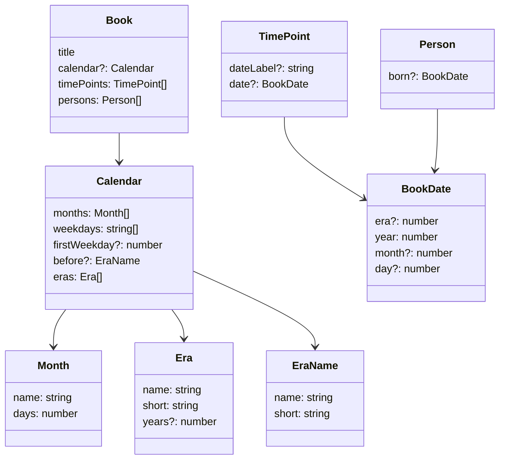
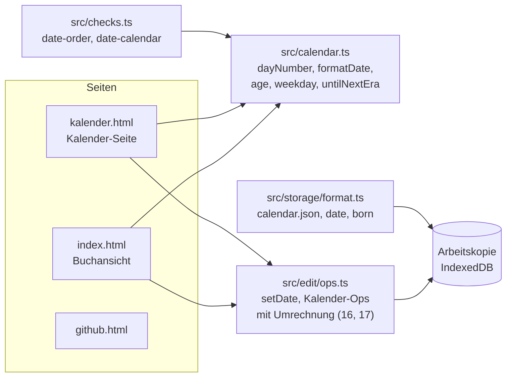

# Vorschlag: Datum, eigener Kalender und Alter

Status: **akzeptiert (2026-11-07)**, zu Issue #3. Prototyp: [2026-11-kalender.html](2026-11-kalender.html).

## Umsetzungsstand (2026-11-07)

Alle Festlegungen sind umgesetzt. Ergänzt wurde, was die bestehende Hinweis-Mechanik verlangt: Beide
Hinweise haben im Dialog je zwei Lösungen (`date-order`: Datum des früheren Zeitpunkts übernehmen oder
Datum entfernen; `date-calendar`: an den Kalender anpassen oder Datum entfernen), und das Zeitpunkt-Panel
zeigt seine Hinweise. Im Datumsfeld stehen Zeitrechnung und Jahr in einer Zeile, Monat und Tag darunter,
damit Monatsnamen in die Panelbreite passen.

Ziel: Zeitpunkte und Personen können ein maschinenlesbares Datum haben. Daraus ergibt sich das Alter einer
Person zu jedem Zeitpunkt. Ein Buch kann optional einen eigenen Kalender festlegen, mit Monaten,
Wochentagen und Zeitrechnungen. Den Kalender bearbeitet man auf einer eigenen Seite `kalender.html`,
neben der Buchansicht und der GitHub-Seite.

Das Issue schlug die Felder `year` und `birthYear` vor. Dieser Vorschlag ersetzt sie durch ein Datum mit
Jahr, Monat und Tag, so wie in der Rückfrage gewünscht.

## Festlegungen aus der Rückfrage

| # | Festlegung | Begründung |
|---|---|---|
| 1 | **`FORMAT` bleibt 1**, alle neuen Felder sind optional | Bestehende Bücher bleiben gültig. Ältere App-Versionen melden betroffene Dateien als fehlerhaft und lassen sie unverändert, `calendar.json` übergehen sie still |
| 2 | Ein Datum besteht aus **Jahr, optional Monat, optional Tag**. Ein Monat braucht ein Jahr, ein Tag braucht einen Monat | Grob planen und später genauer werden, ohne Platzhalterwerte |
| 3 | **Ohne eigenen Kalender gibt es nur Jahreszahlen**, ganze Zahlen, auch 0 und negativ | Keine Annahme über die Welt des Buchs |
| 4 | Ein eigener Kalender legt **Monate, Wochentage und Zeitrechnungen** fest, aber keine Schaltjahre | So ausgewählt |
| 5 | **Zeitrechnungen folgen aufeinander**, jede beginnt bei Jahr 1. **Vor der ersten** wird rückwärts gezählt (wie v. Chr.) | So ausgewählt |
| 6 | Ein **ⓘ mit Tooltip** zeigt bei einem Datum, wie viele Jahre es vor dem Beginn der nächsten Zeitrechnung liegt | So gewünscht |
| 7 | Der **Wochentag** steht beim Datum, wenn es Jahr, Monat und Tag hat | So ausgewählt |
| 8 | Der Kalender wird auf der **eigenen Seite `kalender.html`** bearbeitet | So gewünscht; die Buchansicht bleibt frei von selten genutzter Einrichtung |

## Weitere Festlegungen

### Datenmodell

| # | Festlegung | Begründung |
|---|---|---|
| 9 | Neuer Typ **`BookDate { era?, year, month?, day? }`**, Monat und Tag ab 1 | Ein Typ für Zeitpunkte und Personen, auch Werkzeuge können ihn lesen |
| 10 | `TimePoint.date?: BookDate`, `Person.born?: BookDate`. **`dateLabel` bleibt** als freie Bezeichnung (z. B. „Frühling“) | Das Datum dient zum Rechnen, die Bezeichnung zum Lesen |
| 11 | **Zeitrechnung und Monat als Nummer** in Kalenderreihenfolge: `era` 1, 2, … sind die Zeitrechnungen, `era` 0 ist „vor der ersten“. Ohne Zeitrechnungen fehlt `era` | Die Dateien bleiben lesbar (`"month": 3`). Eine eigene ID wäre nur beim Umsortieren robuster, das übernimmt Festlegung 16 |
| 12 | Das Jahr zählt **innerhalb seiner Zeitrechnung**: Bei `era` ≥ 1 ab 1, bei `era` 0 rückwärts ab 1 („1 vor …“ ist das letzte Jahr davor) | Man schreibt das Datum so, wie es im Buch steht. Wird eine Zeitrechnung länger, bleibt „Zweites Zeitalter 5“ dasselbe Jahr |
| 13 | Der Kalender liegt in **`calendar.json` im Wurzelordner** des Buchs, optional. Sind Monate, Wochentage und Zeitrechnungen alle leer, entfällt die Datei | Versioniert mit dem Buch, eine Datei, ältere Versionen ignorieren sie |
| 14 | Jede Zeitrechnung hat **Name, Kürzel und Länge in Jahren**; die **letzte ist offen** und hat keine Länge. Für „vor der ersten“ gibt es eigenen Namen und Kürzel | Die Länge braucht man für Alter, Reihenfolge und das ⓘ; die laufende Zeitrechnung endet noch nicht |
| 15 | Wochentage zählen **ab dem ersten Tag von Jahr 1 der ersten Zeitrechnung**, dessen Wochentag im Kalender steht. Ohne Zeitrechnungen ab dem ersten Tag von Jahr 1 | Ein fester Anker, rückwärts lässt sich weiterrechnen |

`calendar.json`:

```json
{
  "months": [
    { "name": "Frostmond", "days": 30 },
    { "name": "Saatmond", "days": 31 }
  ],
  "weekdays": ["Erdtag", "Wassertag", "Feuertag", "Windtag", "Ruhetag"],
  "firstWeekday": 3,
  "before": { "name": "vor dem Ersten Zeitalter", "short": "v. E." },
  "eras": [
    { "name": "Erstes Zeitalter", "short": "E.", "years": 590 },
    { "name": "Zweites Zeitalter", "short": "Z." }
  ]
}
```

`time-points/ankunft-t1a2.json` und `persons/anna-a3k9.json` (Auszug):

```json
{ "id": "t1a2", "name": "Ankunft in Velmar", "dateLabel": "Frühling", "date": { "era": 2, "year": 412, "month": 2, "day": 14 }, "order": 1 }
```

```json
{ "id": "a3k9", "name": "Anna", "born": { "era": 2, "year": 389 }, "color": "#e07a5f", "existence": {} }
```



### Rechnen

| # | Festlegung | Begründung |
|---|---|---|
| 16 | Ändert man auf der Kalender-Seite die **Reihenfolge** von Monaten oder Zeitrechnungen, passt dieselbe Änderung **alle Daten im Buch** an. **Entfernen** ist verhindert, solange ein Datum den Monat oder die Zeitrechnung nutzt (Meldung mit Anzahl) | Nummern bleiben lesbar und trotzdem richtig, ein Rückgängig macht alles zusammen rückgängig |
| 17 | Legt man die **erste Zeitrechnung** an, werden bisherige Jahre umgerechnet: Jahr ≥ 1 kommt in die neue Zeitrechnung, Jahr ≤ 0 nach „vor der ersten“ (0 → 1, −5 → 6). Die **einzige verbliebene** Zeitrechnung lässt sich auch in Benutzung entfernen, dann wird umgekehrt gerechnet. Bekommt eine bisher offene Zeitrechnung eine Nachfolgerin, erhält sie als Länge das höchste genutzte Jahr, sonst 100 | Kein Datum verschiebt sich auf der Zeitachse |
| 18 | **Alter** = volle Jahre zwischen Geburt und Datum des Zeitpunkts. Fehlt auf einer Seite Monat oder Tag, rechnet es nur mit Jahren und zeigt **„ca. 34 Jahre“** | Mit nur Jahren kann das Alter um eins danebenliegen, das „ca.“ sagt das ehrlich |
| 19 | Liegt der Zeitpunkt vor der Geburt, zeigt das Panel **„noch nicht geboren“**. Fehlt eines der Daten, gibt es keine Zeile Alter | Keine negativen Alter, keine leere Zeile |
| 20 | Das **ⓘ** erscheint nur, wenn es eine nächste Zeitrechnung gibt. Tooltip: „178 Jahre vor Beginn von „Drittes Zeitalter““, bei „vor der ersten“ entsprechend bis zur ersten | Bei der laufenden Zeitrechnung gibt es nichts anzuzeigen |
| 21 | Gerechnet wird über eine **fortlaufende Tageszahl** (`dayNumber`) bzw. Jahreszahl, wenn Monate fehlen; alle Funktionen liegen in **`src/calendar.ts`** | Alter, Reihenfolge, Wochentag und ⓘ nutzen dieselbe Umrechnung |

### Prüfungen (Festlegung 14 des Datenmodells)

| # | Festlegung | Begründung |
|---|---|---|
| 22 | **Hinweis `date-order`**: Ein späterer Zeitpunkt hat ein früheres Datum als ein vorheriger. Verglichen wird in der gemeinsamen Genauigkeit, gleiche Daten sind erlaubt | Steht so im Issue; mehrere Zeitpunkte im selben Jahr sind normal |
| 23 | **Hinweis `date-calendar`**: Ein Datum passt nicht zum Kalender (Zeitrechnung oder Monat fehlt, Tag zu groß, Jahr jenseits der Länge, Monat ohne Monate im Kalender) | Kann nach Kalenderänderungen oder Merges entstehen und soll das Laden nicht sperren |
| 24 | **Verbote** beim Bearbeiten wie bisher: Tag ohne Monat, Monat ohne Jahr, Jahr in einer Zeitrechnung kleiner 1, `calendar.json` mit falschem Aufbau | Das sind Formfehler, keine Fragen der Geschichte |

### Oberfläche (siehe Prototyp)

| # | Festlegung | Begründung |
|---|---|---|
| 25 | **Panel Zeitpunkt**: Zeile „Datum“ mit Zeitrechnung, Jahr, Monat, Tag; die bisherige Zeile heißt **„Bezeichnung“** (Platzhalter „z. B. Frühling“). Monat und Tag sind gesperrt, bis das vorige Feld gesetzt ist; ohne Monate im Kalender gibt es nur das Jahr | Folgt Festlegung 2, und die Felder erklären sich selbst |
| 26 | **Zeitleiste**: hinter dem Namen erst die Bezeichnung, dann das Datum mit Wochentag und ⓘ, z. B. „Frühling · Feuertag, 14. Saatmond 412 Z. ⓘ“ | Man sieht beim Durchblättern, wo man ist |
| 27 | **Panel Person**: Zeile „Geboren“ (gleiche Felder) und darunter „Alter“ zum aktuellen Zeitpunkt, nur lesbar | Steht so im Issue, das Alter ändert sich beim Wechsel des Zeitpunkts mit |
| 28 | **Werkzeugleiste**: neben dem Link „GitHub“ ein Link **„Kalender“** zur Seite | Gleiches Muster wie die GitHub-Seite |
| 29 | **Kalender-Seite**: drei Abschnitte **Monate**, **Wochentage**, **Zeitrechnungen** und eine Vorschau mit Jahreslänge und Beispieldatum. Listen mit Hinzufügen, Entfernen und Verschieben (↑ ↓) | Alles auf einer Seite, die Vorschau zeigt sofort die Wirkung |
| 30 | Die Kalender-Seite **bearbeitet die Arbeitskopie des angezeigten Buchs** über `useEditor`: automatisch gespeichert, Rückgängig mit `Strg+Z`, die offene Buchansicht lädt beim Zurückkehren neu (Festlegung 57 des Editors) | Gleicher Speicherweg wie der Editor, keine zweite Speicherlogik |
| 31 | Die **Suche** zeigt bei Zeitpunkten Bezeichnung und Datum | Man findet „412“ oder „Saatmond“ |

## Architektur



Betroffene Stellen:

- `src/model.ts`: Typen `BookDate`, `Calendar`; Felder an `Book`, `TimePoint`, `Person`.
- `src/calendar.ts` (neu): Umrechnung und Anzeige.
- `src/storage/format.ts`: `calendar.json` lesen und schreiben, `date` und `born` in den Specs.
- `src/checks.ts`: zwei Hinweisregeln, Verbote nach 24.
- `src/edit/ops.ts`: Datum setzen, Kalender ändern mit Umrechnung.
- `src/ui/panel/OtherPanels.tsx`, `ElementPanel.tsx`, `Bars.tsx`, `Search.tsx`: Felder und Anzeige.
- `kalender.html`, `src/calendar/` (neu): Seite, als weiterer Einstieg in `vite.config.ts`.
- `beispiel/`: Kalender und einige Daten, damit `check:beispiel` sie abdeckt.

## Tests

- `calendar.test.ts`: Tageszahl, Wochentag, Alter (genau und „ca.“), ⓘ, rückwärts gezählte Jahre, Kalender
  ohne Monate und ohne Zeitrechnungen.
- `format.test.ts`: Lesen und unverändertes Zurückschreiben von `calendar.json`, `date` und `born`.
- `checks.test.ts`: `date-order` und `date-calendar`.
- `ops.test.ts`: Verschieben und Entfernen von Monaten und Zeitrechnungen, erste Zeitrechnung anlegen.
- E2E: Datum am Zeitpunkt setzen, Alter im Personen-Panel beim Zeitpunktwechsel, Kalender-Seite ändern und
  Wirkung in der Buchansicht.

## Verworfene Alternativen

| Alternative | Warum nicht |
|---|---|
| `year` und `birthYear` als einzelne Zahlen (Issue) | Reicht nicht für Monate, Tage und Wochentage |
| `FORMAT` auf 2 | Vom Nutzer abgelehnt; erzeugt in jedem Buch eine Änderung an `booktime.json` |
| Gregorianischer Kalender als Standard | Vom Nutzer abgelehnt, ohne Kalender gibt es nur Jahre |
| Schaltjahre | Vom Nutzer nicht ausgewählt |
| Datum als fortlaufendes absolutes Jahr speichern | In den Dateien schwer lesbar; eine längere Zeitrechnung würde alle späteren Daten verschieben |
| IDs für Monate und Zeitrechnungen | Dateien weniger lesbar; die Umrechnung beim Umsortieren (16) leistet dasselbe |
| Alter als Spanne „33–34“ | Unruhig, „ca.“ sagt dasselbe kürzer |
| Kalender im Panel der Buchansicht bearbeiten | Vom Nutzer anders gewünscht |
| Eigene Speicherlogik für die Kalender-Seite | `useEditor` speichert schon als Dateiunterschied und hat Rückgängig |

## Nicht Teil dieses Vorschlags

- Schaltjahre, Uhrzeiten, Sterbedatum.
- Zeitpunkte nach Datum automatisch sortieren; die Reihenfolge bleibt manuell, `date-order` weist nur hin.
- Datum an Events oder Fakten.
