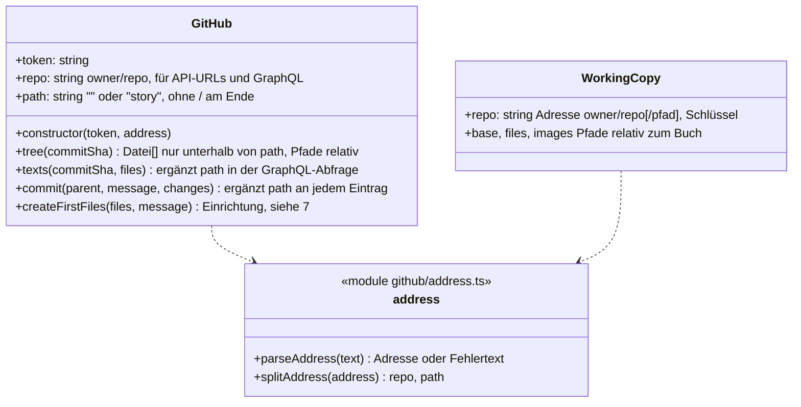
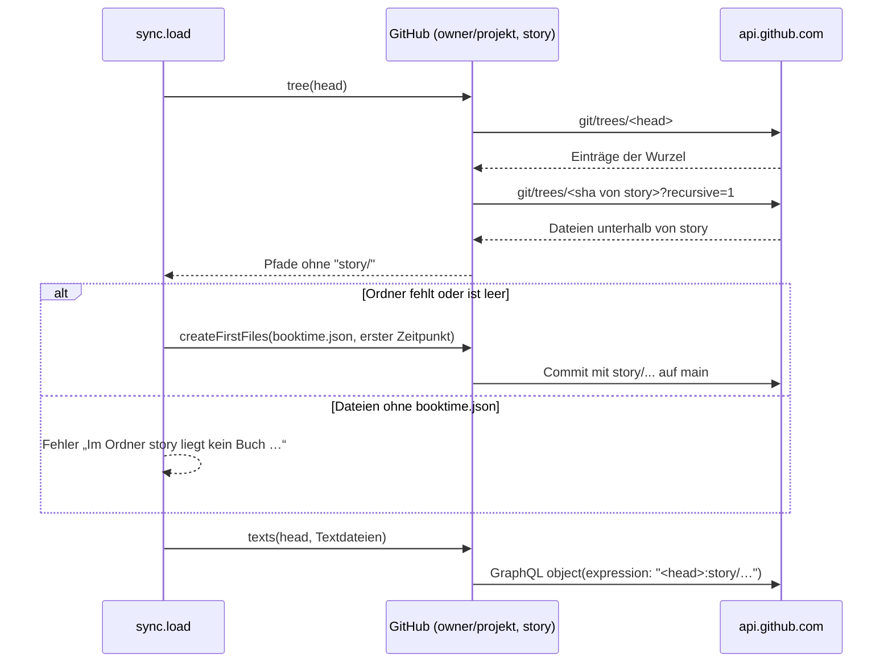

# Vorschlag: Buch in einem Unterordner eines Repos

Status: **akzeptiert (2026-11-07)**, zu Issue #2.

## Umsetzungsstand (2026-11-07)

Alle Festlegungen sind umgesetzt. Abweichung bei 9: Die Meldung lautet „Den Ordner bitte selbst mit einer
booktime.json anlegen, Inhalt {}.“, weil eine leere Datei kein gültiges JSON wäre.

Ziel: Ein Buch kann in einem Unterordner eines Repos liegen, das sonst anderen Code enthält, zum Beispiel
`owner/projekt/story`. Pro Repo gibt es weiterhin höchstens ein Buch. Bücher im Stammverzeichnis
(`owner/repo`) funktionieren unverändert.

## Festlegungen

| # | Festlegung | Begründung |
|---|---|---|
| 1 | Ein Buch wird als **Adresse `owner/repo` oder `owner/repo/pfad`** hinzugefügt, der Pfad darf mehrere Ebenen haben (`owner/repo/docs/story`) | Eine Zeile wie bisher, der Pfad hängt einfach an |
| 2 | **Höchstens ein Buch pro Repo**, der Arbeitsbranch bleibt `<login>/arbeit` | So vom Nutzer festgelegt; Branch-Logik, Ausweichbranch und Pull Request bleiben unverändert |
| 3 | Die Adresse ist der **Schlüssel des Buchs**: Bücherliste, angezeigtes Buch und Arbeitskopie (`WorkingCopy.repo`) speichern die ganze Adresse | Keine Migration der IndexedDB und des localStorage nötig, bestehende Einträge `owner/repo` bleiben gültig |
| 4 | Die **`GitHub`-Klasse trennt** die Adresse in Repo und Pfad. Nach außen sind alle Dateipfade relativ zum Buch, das Präfix ergänzt bzw. entfernt nur die Klasse | `sync.ts`, `format.ts`, Editor und Arbeitskopie bleiben unverändert, das Präfix steht an einer Stelle |
| 5 | **Laden holt nur den Baum des Unterordners**: Die Klasse folgt dem Pfad über die Bäume ohne `recursive` und lädt erst den Ordner selbst rekursiv | Fremder Code wird nicht geladen; große Repos sprengen nicht die Grenze von `recursive` (100 000 Einträge) |
| 6 | **Fremde Dateien landen nie in der Arbeitskopie**, Commits berühren nur Pfade unterhalb des Ordners | Commits bauen weiter auf `base_tree` auf, der Rest des Repos bleibt so, wie er ist |
| 7 | **Einrichtung direkt auf dem Standardbranch**: Fehlt der Ordner oder ist er leer, committet die App `pfad/booktime.json` und den ersten Zeitpunkt in einem Commit auf den Standardbranch, Titel = letzter Teil des Pfads | So vom Nutzer festgelegt, gleiches Vorgehen wie heute beim leeren Repo |
| 8 | Enthält der Ordner **Dateien, aber kein `booktime.json`**, lädt die App nichts und meldet: „Im Ordner pfad liegt kein Buch. Bitte einen leeren oder neuen Ordner angeben.“ | Ein Ordner mit fremdem Inhalt wird nicht ungefragt zum Buch |
| 9 | Ist der **Standardbranch geschützt**, scheitert die Einrichtung mit der Meldung von GitHub, ergänzt um: „Den Ordner bitte selbst mit einer leeren booktime.json anlegen.“ | Kein eigener Umweg über Branch und Pull Request nur für diesen Fall |
| 10 | Links zu Dateien auf github.com und die Anzeige auf der GitHub-Seite nutzen den **vollen Pfad** | Ein Klick auf eine fehlerhafte Datei soll sie im Repo zeigen |
| 11 | Die **Repo-Größe** zeigt weiter die Größe des ganzen Repos | Nur diese Zahl liefert GitHub, und die Grenze gilt für das ganze Repo |
| 12 | Das Feld heißt **„Buch hinzufügen“**, Platzhalter `owner/repo oder owner/repo/ordner`. Ein Link `https://github.com/owner/repo` wird wie bisher gekürzt, Links mit `/tree/<branch>/` werden abgelehnt: „Bitte als owner/repo/ordner angeben.“ | Branchnamen können `/` enthalten, der Pfad wäre aus so einem Link nicht eindeutig |

Die Festlegungen 11 und 12 der Speicherung ([2026-10-speicherung-github.md](2026-10-speicherung-github.md))
werden um den Pfad erweitert. Issue #1 betrifft damit nur noch Bücher im Stammverzeichnis.

## Architektur

Laden eines Buchs im Unterordner:

Betroffene Stellen:

- `src/github/address.ts` (neu): Adresse prüfen und in Repo und Pfad trennen; ersetzt `REPO` in `GitHubPage.tsx`.
- `src/github/api.ts`: Pfad in `tree`, `texts`, `commit`; `createFirstFile` wird zu `createFirstFiles`, das
  auch bei vorhandenem Standardbranch einen Commit macht.
- `src/github/sync.ts`: Einrichtung nach 7 und 8, Titel aus dem letzten Pfadteil.
- `src/github/GitHubPage.tsx`: Eingabe nach 12, Links nach 10.
- `src/storage/active.ts`: `new GitHub(key, copy.repo)` bleibt, die Klasse trennt selbst.

## Tests

- `address.test.ts`: gültige und ungültige Adressen, gekürzter Link, abgelehnter `/tree/`-Link.
- `sync.test.ts` (Fake-GitHub um Unterordner erweitert): Buch unter `owner/repo/story` laden, bearbeiten,
  pushen und zusammenführen; Commits ändern nur Pfade unter `story/`; fremde Dateien im Repo bleiben
  unverändert; leerer Ordner wird auf `main` eingerichtet; Ordner mit fremden Dateien ergibt den Fehler;
  `owner/repo` verhält sich wie bisher.

## Verworfene Alternativen

| Alternative | Warum nicht |
|---|---|
| Mehrere Bücher pro Repo, Branch pro Buch | Laut Nutzer nicht nötig, würde Branch- und Pull-Request-Logik verdoppeln |
| Präfix in `sync.ts` statt in der `GitHub`-Klasse | Das Präfix stünde an vielen Stellen (`load`, `push`, Bilder), leicht zu vergessen |
| Ganzen Repo-Baum laden und filtern | Lädt fremden Code mit und scheitert bei sehr großen Repos an der Grenze von `recursive` |
| Repo und Pfad als getrennte Felder in der Arbeitskopie | Bräuchte eine Migration von IndexedDB und localStorage ohne Mehrwert |
| Einrichtung über Arbeitsbranch und Pull Request | Nutzer hat sich für den direkten Commit entschieden |
| Pfad aus `/tree/<branch>/`-Links ableiten | Nicht eindeutig, wenn der Branchname `/` enthält |

## Nicht Teil dieses Vorschlags

- Ein Buch nachträglich in einen anderen Ordner verschieben.
- Issue #1 (fremde Dateien bei Büchern im Stammverzeichnis), das bleibt eigenständig.
