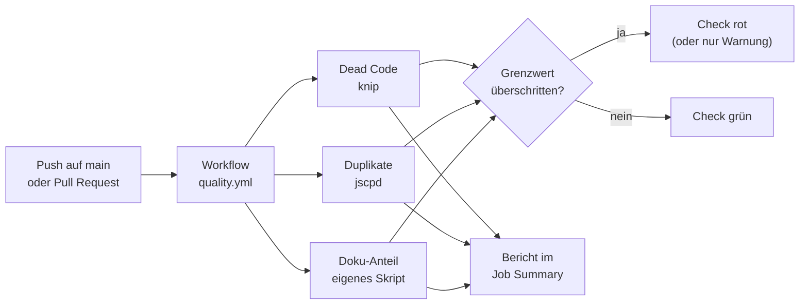
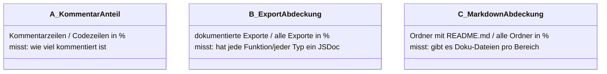

# Vorschlag: Code-Qualitäts-Workflows

Status: **freigegeben und umgesetzt** – knip + jscpd; Doku: Exporte 100 % JSDoc, alle Kommentare inkl. JSDoc ≤ 5 %; Fehlschlagen bei Verstoß; Auslöser Push, PR, manuell

Ziel: automatische Prüfung auf toten Code, duplizierten Code und den Anteil an Inline-Dokumentation.

## Ablauf

Der bestehende Deploy-Workflow bleibt unverändert. Die Prüfungen laufen in einem eigenen Workflow
`quality.yml`, damit ein Qualitätsproblem das Deployment nicht blockiert (siehe Entscheidung 3).

## Entscheidung 1: Dead Code

| Option | Bewertung |
|---|---|
| **knip** 6.41 (empfohlen) | Findet ungenutzte Dateien, Exporte, Typen **und** ungenutzte npm-Abhängigkeiten. Kennt Vite und React von selbst, aktiv gepflegt, ISC. |
| ts-prune | Nur ungenutzte Exporte, seit 2022 nicht mehr gepflegt. |

## Entscheidung 2: Duplizierter Code

| Option | Bewertung |
|---|---|
| **jscpd** 5.4 (empfohlen) | Standard-Tool, versteht TS/TSX, gibt Duplikat-Anteil in % aus und kann bei Grenzwert fehlschlagen. MIT. |
| SonarCloud | Mächtiger, aber externer Dienst mit Konto – zu viel für dieses Projekt. |

Vorgeschlagene Einstellung: Blöcke ab 50 Tokens / 5 Zeilen, Grenzwert 3 % Duplikate.

## Entscheidung 3: Doku-Anteil – **Bedeutung unklar, bitte präzisieren**

„Prozentanteil an Inline-Doc / .md-Files“ lässt sich unterschiedlich verstehen:

| Option | Umsetzung | Bewertung |
|---|---|---|
| **A** Kommentar-Anteil | kleines Node-Skript mit der TypeScript-API (keine neue Abhängigkeit) | Einfach, aber belohnt Masse statt Qualität. |
| **B** Export-Abdeckung (empfohlen) | Node-Skript mit der TypeScript-API | Aussagekräftig: zeigt genau, welche öffentliche Funktion/welcher Typ undokumentiert ist. |
| **C** Markdown-Abdeckung | Node-Skript | Misst Doku-Dateien statt Inline-Doku. |

Verworfen: `cloc` (GPL, braucht Perl), `typedoc --validation` (erzeugt eine ganze Doku-Seite, nur um zu zählen).

Das Ergebnis würde zusätzlich als Markdown-Tabelle in die **Job Summary** des Workflows geschrieben,
also direkt auf der Actions-Seite sichtbar.

## Entscheidung 4: Verhalten bei Verstößen

| Option | Bewertung |
|---|---|
| Nur berichten | Nie rot, nur Zahlen in der Job Summary. Gut zum Einstieg. |
| **Fehlschlagen bei Grenzwert** (empfohlen) | Dead Code: jeder Fund = rot. Duplikate: > 3 % = rot. Doku: unter Grenzwert = rot (Startwert nach erster Messung festlegen). |

## Entscheidung 5: Auslöser

Empfehlung: bei Push auf `main`, bei Pull Requests und manuell (`workflow_dispatch`).
Zusätzlich lokal über `npm run check:dead`, `npm run check:dup` und `npm run check:docs`.
